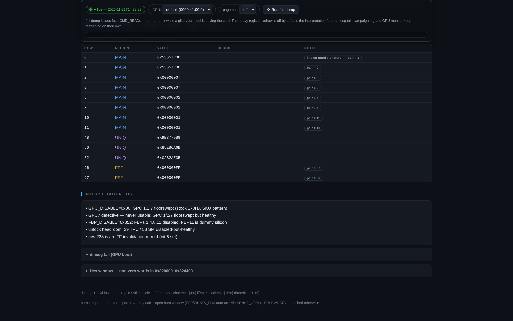
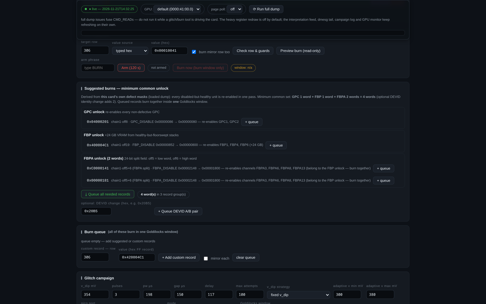
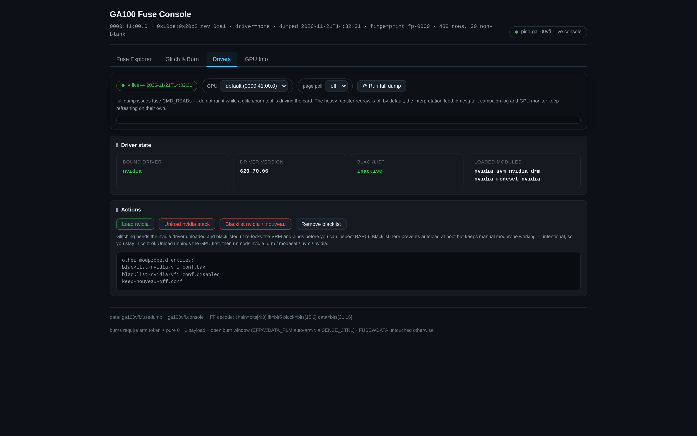
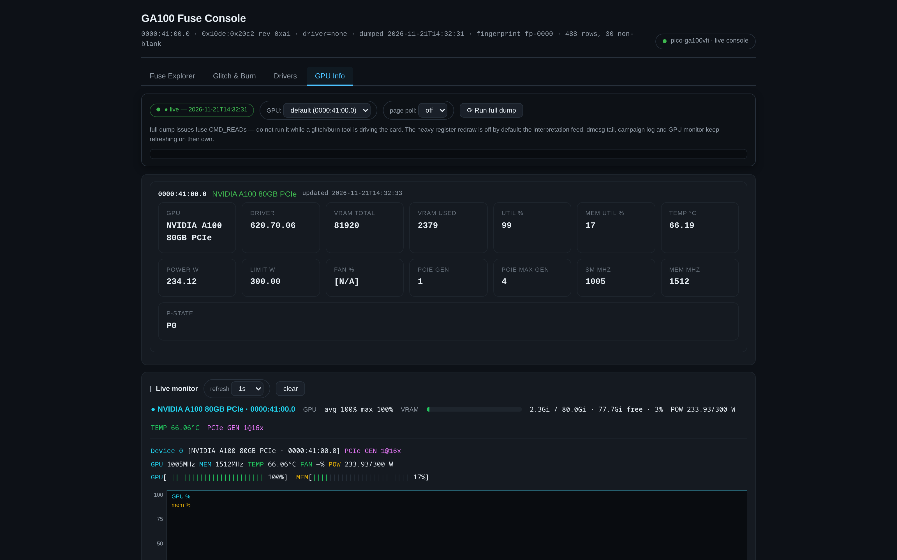

# Fuse Console

A self-contained web GUI + service for GA100 (CMP 170HX) fuse work: live
register/fuse viewing, glitch campaigns, guarded fuse burns, driver control,
and GPU status — all in the `ga100vfi` package, driven from a browser.

This document has three parts: **how to run it**, **how to use it**
(a tour of the tabs, the step-by-step workflows, and what every indicator
means), and **reference** (burn safety model, HTTP API, systemd, testing).
For a plain-language operating manual (safeguard table, success reading,
failure recovery, glossary) see the [User Guide](USER-GUIDE.md).

## Requirements

- Linux host with the CMP 170HX installed and the pico plugged into the
  **same host** (`/dev/ttyACM0` — campaigns need serial control of the pico
  and PCIe BAR0 access to the card simultaneously).
- The `ga100vfi` package importable (`pip install -e host/` or
  `PYTHONPATH=host`), with `pyserial`.
- Root — BAR0 access goes through sysfs `resource0`, and the driver
  blacklist actions write `/etc/modprobe.d`.
- Any browser on the same LAN. The service has **no authentication**: run it
  on a trusted network or front it with your own auth proxy.

## Starting the console

```sh
sudo python3 -m ga100vfi.console --port 8790
# or, after `pip install -e host/`:
sudo ga100vfi-console --port 8790
# the card is auto-detected; pass --bdf only to choose which card the
# Fuse Explorer watches on a multi-GPU host (burns pick any GA100 at runtime)
```

Then open `http://<host>:8790`. The service generates its own `live.html`
at startup (seeded from the newest dump it can find) and serves everything
from memory — no web server to install.

Useful flags:

| Flag | Default | Meaning |
|---|---|---|
| `--bdf` | auto-detected | the card the Fuse Explorer tab watches live |
| `--port` | `8790` | HTTP port |
| `--state-dir` | `~/ga100-fuse-view` | full dumps, generated `live.html`, `goldilocks.jsonl` |
| `--poll` | `1.0` | server-side probe interval (seconds) |
| `--rows` | `0-487` | row range for full dumps |
| `--ff-buffer` / `--ff-tail-reserve` / `--ff-sm-reserve` | 4 / 12 / 16 | burn placement policy zones |

For a permanent install see [the systemd unit](#systemd-example) below —
order it after `network.target`, not `multi-user.target`, or it can come up
minutes late on slow boots.

## A tour of the tabs

### Fuse Explorer

The live view of the card the service was started with.



- **Refresh model (default: calm)**: the heavy full-page register redraw
  is **off by default** — pick a rate in the `page poll` selector only
  when you want the register grid to live-redraw. What keeps refreshing
  regardless: the **interpretation feed** (register-change diff, 2 s),
  the **dmesg tail** (GPU-relevant lines, 2 s), the **Glitch campaign
  log** (1 s), the **Drivers log**, and the **GPU Info monitor** (1 s,
  user-adjustable 1–10 s or off). All pollers pause when the browser tab
  is hidden.
- **Safety guard**: while the `nvidia` driver is bound to the card, the
  server-side BAR0 poller **pauses itself** (live indicator shows
  `⏸ driver bound`). Raw BAR0 reads against a GSP-driven card can wedge
  the GSP into a state only a full power-cycle recovers. Unload the
  driver (Drivers tab) to resume live register viewing.
- **Live feed**: status + shadow register changes flash amber and land in
  the activity feed; you will see `DSOV` flip `1 → 0` the moment a
  glitch lands.
- **⟳ Run full dump**: all fuse rows 0–487 via the fuse-macro `CMD_READ`
  path, plus the hex window and dmesg, archived to
  `<state-dir>/dumps/<ts>/`. The page requests one automatically on
  load; while a campaign is running the server refuses it (a mid-campaign
  sweep could push classify past the Goldilocks window).
- **Topology**: GPC/FBP floorsweep vs. defective masks, with a state
  selector (pre-glitch reference / intended / NOW) — dead silicon that is
  *enabled* is drawn red-hatched.
- **TPC map — SM availability per GPC**: one row per GPC, 8 TPC cells
  each (2 SM per TPC). Cell colours: **green** = enabled now, **yellow** =
  disabled-but-healthy (unlock headroom), **red** = defective silicon
  (never usable). Per-GPC line: `SM now · after unlock · defective SM
  (+ recoverable)`; totals pills at the bottom.
  - Sources: TPC **defective** array `0x820760 + gpc·4`, effective TPC
    **disable** array `0x820C38 + gpc·4` (defective ⊆ disable; the extra
    bits are factory-disabled-but-healthy).
  - *After unlock* is the **fuse ceiling**: `(8 − defective TPC) × 2 SM`
    per non-defective GPC. It assumes the GPC-level floorsweep is
    unlocked too — the TPC mask is separate from `GPC_DISABLE`. Cells in
    a floorswept or dead GPC are dimmed: their health is shown, but they
    only run once the GPC itself is enabled.
  - Note: a GPC can be unflagged in `GPC_DEFECTIVE` yet fully defective
    at TPC granularity (e.g. GPC2 with all 8 TPCs masked) — the TPC map
    exposes this; the GPC-level topology view cannot.
- **Row explorer**: every fuse row with region colouring (MAIN / UNIQ /
  FPF / FF), pairing, and the verified FF-record decode
  (`chain`, `iff`, `block`, `data`). Click a row for its 32-bit breakdown.
- dmesg and hex-window browsers underneath.

### Glitch & Burn

The campaign control room. Everything targets the GPU picked in the
**Target** card at the top (serial + bound driver + live Goldilocks state).
Below it: the **burn placement policy** (rules + a live row map of the FF
region + the remaining burn budget), the **burn payload** form, and the
**campaign** controls. See the workflows below for the full sequence.

The burn payload form has a **value source** selector: *typed hex*, or
*from dump row* — enter the row of an existing record and the console
grabs its value from the loaded dump and shows it decoded
(`FF ch·blk·data`, known block names, IFF flagged) for verification, so
burn values never have to be typed by hand. Blank or missing source rows
warn instead of proposing a burn of zero.



### Drivers

Live driver state (bound driver, module list, version, blacklist status) and
Load / Unload stack / Blacklist nvidia+nouveau / Remove blacklist actions
with two-step confirm buttons. Glitching needs `nvidia` unloaded **and**
blacklisted — the driver re-locks the VRM and binds the card before you can
inspect BAR0. The blacklist written here still allows manual `modprobe`, so
you stay in control.



### GPU Info

nvidia-smi card grid (auto-refresh) + `lspci` link state. Reports the
`nvidia-smi` error string honestly when the card is GFW-dead — that banner
is normal until the card boots cleanly.



## Workflows

### 1. Look at a card (read-only, zero risk)

1. Start the console and open it. The status cards tell you the fuse-block
   health (`CRC_STATUS == 0x55` = parses cleanly) and lock state
   (`DSOV = 1` = factory-locked, the normal state).
2. Press **⟳ Run full dump**. After a few seconds the row explorer fills in;
   filter to *FF records* to see every chain/block/data triple.
3. The dump is archived under `<state-dir>/dumps/<ts>/` — re-open it later
   with `python3 -m ga100vfi.console.gui <dump_dir> out.html`.

### 2. Prepare the host for glitching

1. Open the **Drivers** tab.
2. **Unload nvidia stack** (click, then confirm). **Blacklist nvidia +
   nouveau** (click, then confirm) so a reboot doesn't re-bind it.
3. The state cards should now show `bound: none`. A campaign will refuse to
   start otherwise (see Troubleshooting).

Reverse with **Load nvidia** / **Remove blacklist** when you're done.

### 3. Glitch to Goldilocks

1. **Glitch & Burn** tab → Target card: pick the GPU (the pill shows its
   live state; the serial identifies the physical card) and the pico port
   (dropdown, with a rescan button).
2. Campaign card: choose the **v_dip strategy**. `fixed` uses your v_dip
   value; `adaptive` (recommended for a card you haven't characterised)
   runs the 3D CRC-guided search over (v_dip, delay, pw) and converges
   on the card's window.
3. Mode: **classify only** — no burns, just observe.
4. **▶ Start campaign** and watch the log: every shot gets a line with its
   `v_dip` and outcome (`under` / `hit` / `over` / `lost`) plus the
   per-attempt classify values. Adaptive mode updates its model from every
   outcome; fixed mode repeats one voltage.
5. When the five checks pass the log prints `<< GOLDILOCKS`, the stats chip
   flips to `goldilocks YES`, and (if you look at the Fuse Explorer tab) the
   feed shows `DSOV: 0x1 → 0x0`. The hit is also appended to
   `<state-dir>/goldilocks.jsonl` with the card serial.
6. **Goldilocks window hold (default):** the campaign's **Goldilocks
   window** dropdown defaults to **hold open — no revert**, so the run
   ends with NVVDD still at glitch voltage and the shadow registers
   writable — time to verify or burn from the Fuse Explorer tab. A
   `window HELD open` chip appears; close the window with **⟲ Revert
   VRM** (manual hand-back to PWM-VID) or a cold boot. Choosing
   **auto-revert VRM** restores the old behavior (the campaign hands the
   VRM back itself on exit). Misses, stops, and errors always revert
   regardless of the dropdown — an interrupted run can never leave NVVDD
   low.
7. **■ Stop** ends a run early (the VRM is handed back). A stopped or
   exhausted campaign leaves the card in whatever state the last shot
   produced — re-run to try again.

### 4. Burn an FF record (the full sequence)

The full confidence sequence is **preview → check → arm → burn →
predicted-vs-actual**.

Prerequisite: a record derived from **this card's own defect masks**
(e.g. via ffcalc) — never blind ffcalc output, and never a payload copied
from another card. Plan the burn against the placement policy: the row map
shows the safe zone, and the row input auto-snaps into it with a ✓/✗ hint.

1. **Burn payload**: pick the **target row** (blank, inside the safe zone).
   For the value, either type it, or — preferred — choose **value source:
   from dump row** and enter the row of an existing record: the console
   grabs the value from the loaded dump and shows it decoded
   (`FF ch·blk·data`, plus the known block names) for you to verify —
   no hex typing, no fat fingers. (Re-applying an existing record at a
   later row is exactly how you override a block: last record wins.)
   Press **Preview burn (read-only)** first — the console's version of
   `ga100_burn.py`'s default preview mode. It works ANY time, even on a
   cold-booted card outside any window, with no arm and no token
   (`CMD_READ` is gated by `FUSECTRL_PLM`, not `EFP`), and issues **zero
   fuse writes**: the server path receives a handle whose writes are
   restricted to the `CMD_READ` controller path and raises on anything
   that could latch. The panel shows:
   - `before → Δ → after` per row (mirror included) with the delta bits
     highlighted on the bit strip;
   - both words decoded as FF records (`chain/iff/block/data` + known
     block names) when the row is in the FF region;
   - a **collision scan**: every existing record with the same
     `(chain, block)` key, row-numbered, with a LAST-WINS verdict badge —
     green *will win*, or red *will LOSE to row N* (the burn would be
     **inert**; correct it by burning a later row);
   - **partial-landing hazards**: every subset of the delta that, if only
     it latched, would land a different record on a live key with wrong
     data (with the mask effect it would cause); skipped above 12 delta
     bits ("too many subsets");
   - the **predicted effect** line when decodable (e.g. `FBP_DISABLE data
     0x4290 → 0x4200 (unmasks FBP1/FBP4)`) — `STATUS_OPT_*` shadows update
     only after a power cycle;
   - a read-only window / arm-pending / journal status strip.
   Verdict banner: `SAFE TO BURN` (green) / `WILL BE INERT` (red) /
   `IMPOSSIBLE` (red, bits would clear) / `ALREADY BURNED` (amber).
   Preview is also the one burn-adjacent feature that works in `--mock`
   mode (read-only over the mock rows).
   Then press **Check row & guards**. The result shows the row's current value,
   the 0→1 purity, the **placement policy verdict** (bit-5/IFF values are
   refused), and the **burn window** checks (top-line `SAFE TO BURN` /
   `REFUSED`). `EFP`, `PROGRAM_DIS`, `SBFE`, `WDATA_SECURE` and
   `FUSEWDATA_PLM` are shown amber as *arm pending* — they read closed
   outside a burn by design and are opened at burn time by the SENSE_CTRL
   arm sequence; they never block the check.
2. Type `BURN` into the arm field and press **Arm (120 s)**. The countdown
   shows how long the arm token is valid.
3. Campaign card: mode **burn payload on first Goldilocks**. (The burn runs
   *inside the campaign process* because the Goldilocks PCIe window dies
   seconds after the campaign loop returns — a separate burn call would
   miss it.)
4. **▶ Start campaign**, confirm the dialog (it repeats the exact row,
   value, mirror and target). The campaign glitches; on the first
   Goldilocks it burns the records in-process: each burn re-checks the
   driver-unbound state, journal, GPIO19 preflight and window, runs the
   SENSE_CTRL arm sequence, the EN=1 + GPIO19/TRIGGER program bracket with
   `CMD_WRITE` of the **delta**, and read-back verify logged as
   `row N: VERIFY OK` (a row already latched by an earlier aborted run
   logs `ALREADY BURNED` and still counts as success). The campaign ends
   only when EVERY record succeeds AND — for ≥2-record burns — the whole
   burned image re-reads correctly twice; a burn `ABORT` or
   `IMAGE VERIFY FAILED` is logged and is NOT final — attempts keep
   firing and the window is not held.
5. **Predicted vs actual**: a standalone burn that reaches `VERIFY OK`
   re-reads the burned row(s) and re-runs the collision scan
   (`after_state` in the report). If you ran a Preview of the same payload
   first, the burn report shows a **Predicted vs Actual** table: the
   preview's after-word and LAST-WINS verdict against the post-burn
   readback and post-burn scan — any mismatch is red. Both the last
   preview and the last burn report are stored in the state dir
   (`last-preview.json`, `last-burn.json`, served by `/api/burn/last`).
6. Cold-boot the card, then verify honestly — see workflow 5.

### 5. After a burn: verify and, if needed, correct

- A `VERIFY OK` readback means the bits landed — **not** that the shadow
  followed. After the power cycle, open Fuse Explorer and check
  `STATUS_OPT_GPC` / `STATUS_OPT_FBP`: they are the latch that proves the
  chain took effect. Watch the topology view (NOW state) to see the floorsweep
  change.
- If a record was wrong or the shadow didn't follow: the fix is a **later**
  record for the same block (last record per block wins). Use the next free
  row in the safe zone — the revert tail at the end of the region exists
  exactly for this, which is why the policy keeps it empty.
- SMs that turn out to be actually bad after unlocking: re-disable them
  with records in the **SM reserve** zone (kept free for this).
- Every burn consumes a row; the budget pill counts down. Attempts are
  finite — plan records before arming.

## Reading the UI

| Indicator | States and meaning |
|---|---|
| live bar pill (top) | `● live — <time>` polling fine · `⚠ service unreachable` page lost the server · `⚠ BAR0 unreadable` card link is down — **normal mid-glitch** |
| activity feed | timestamped register changes; flashes the matching card |
| target GPU pill | `● Goldilocks — glitch window` (4-check read-only approximation) · `locked (DSOV=1) — glitch first` · `⚠ unreadable` |
| burn window pill | `● burn window open` · `burn window closed (<failed bits>)` · `window: n/a` — read-only verdict from `/api/live` (`window_ok` + `window_checks`) |
| serial pill | `SN <serial> · driver <name>` — identifies the physical card |
| row hint | `✓ safe zone` · `✗ occupied (boot FF)` · `✗ buffer zone` · `✗ SM reserve` · `✗ revert tail` |
| value source decode | `dump row N → 0x…` + decoded `FF ch·blk·data` (with block names) — verify before Check · blank/missing rows warn · IFF records flagged |
| Preview burn button | enabled whenever row+value are set — **no window/arm/token requirement** (read-only works on a cold card and in mock); panel: verdict banner `SAFE TO BURN`/`WILL BE INERT`/`IMPOSSIBLE`/`ALREADY BURNED`, before→Δ→after with delta bits highlighted, FF decode table, LAST-WINS collision badge (green win / red lose), amber hazard list, predicted effect, window/arm/journal strip |
| budget pill | safe zone rows, free count, last boot FF row |
| arm pill | `● armed Ns` (countdown) · `not armed` · red = rejected phrase |
| Burn now button | enabled only when armed **and** the burn window verdict is open (`window_ok`; EFP/WDATA_PLM do not gate it) |
| campaign pill | `● running` · `goldilocks` · `stopped` / `exhausted` · `error` |
| stats chips | attempts / valid / lost / nack / dsov=0 / goldilocks / burn aborts / image verify failed |
| burn report | result line: `VERIFY OK` green · `ALREADY BURNED` amber (partial-run recovery, zero writes) · `ABORT` / `VERIFY FAIL` / `IMAGE VERIFY FAILED` red; journal-uncertain → explicit confirm before retrying with `ack_uncertain`; `VERIFY OK` adds `after_state` + the Predicted vs Actual table when a matching preview was run |

## Burn safety model (reference)

Every burn — standalone or in-campaign — passes ALL of these, re-verified
server-side immediately before `CMD_WRITE`:

1. **Arm token**: typed phrase `BURN`, 120 s TTL.
2. **Driver unbound**: the target must have no driver bound (same sysfs
   source as the Drivers tab) — mirrors `bar.require_unbound()`; a bound
   driver aborts before any write.
3. **Journal resolved**: an unresolved `command_may_be_issued` in
   `burn_journal.jsonl` (see below) aborts with `journal_uncertain` until
   the request carries `ack_uncertain: true` (the GUI shows an explicit
   confirm dialog).
4. **GPIO19 preflight** (mirrors `ga100_burn.preflight`): `GPIO (0xD65C)`
   must read with normal mux (`& 0xFF == 0`), non-inverted push-pull and
   low latch (`& (0x1000|0x8000|0x40000) == 0`); failure aborts with the
   failing value in the report, before any write.
5. **Pure 0→1 transition**: new value must be a superset of the current row
   value (OTP physics — bits can only be added).
6. **Row state**: the row must currently read exactly the expected old
   value; any drift aborts — **except** a row that already reads exactly
   the intended value (`ALREADY BURNED`): that counts as success with zero
   latching writes, so a mirror pair aborted halfway can still complete.
7. **Burn window** (static, read-only — mirrors `ga100_burn.check_window`):
   `DSOV == 0`, `CRC_STATUS == 0x55`, loader `0x120060 == 0`,
   `FUSECTRL_PLM`/`PRIV_MASK` open, `DEBUGCTRL == 0`, `SWIFF == 0`,
   `IFF_CTRL == 0`, `FUSECTRL` idle (state bits[1:0]==0, stage[20:16]==4).
8. **Arm sequence** (mirrors `ga100_burn.arm`, executed ONLY inside the
   burn itself): if `EFP != 1`, issue `SENSE_CTRL` (`FUSECTRL = 3`, poll to
   idle ≤2 s, at most once per burn attempt — no retry) and re-check the
   window (a failed re-check is fatal); then require `EFP == 1` and
   `PROGRAM_DIS == 0`; write `WDATA_SECURE = 0` and `SBFE = 0`; then require
   `FUSEWDATA_PLM == 0xFFFFFFFF`. The poller, `/api/live` and fusedump
   never touch the write path at all; the burn check issues only
   `CMD_READ` (`FUSEADDR`/`FUSECTRL`) and conditionally clears/restores
   `EN_SW_OVERRIDE` for the read — it never issues SENSE, never writes
   `FUSEWDATA`, never raises `EN_SW_OVERRIDE`, and never touches
   `GPIO`/`TRIGGER`. A static `EFP == 0` or `FUSEWDATA_PLM == 0xFFFFFFF8`
   is normal outside a burn and must not block the check or the burn.
8a. **Preview** (`/api/burn/preview`, mirrors `ga100_burn`'s default
   preview mode) is structurally read-only: it receives a card handle
   whose writes are restricted to the `CMD_READ` controller path
   (`FUSEADDR`, `FUSECTRL = CMD_READ`, `EN_SW_OVERRIDE` clear/restore)
   and RAISE on anything that could latch (`FUSEWDATA`, `GPIO`/`TRIGGER`,
   `WDATA_SECURE`/`SBFE`, `CMD_WRITE`/`CMD_SENSE`). It never SENSEs,
   never arms, needs no token — `CMD_READ` is gated by `FUSECTRL_PLM`,
   not `EFP`, so the preview works on a cold-booted card. It reads the
   FF pool (rows 222–487, stopping at the first IFF record), decodes
   `chain=word[4:0] iff=bit5 block=word[15:6] data=word[31:16]`, and
   applies the controller's last-record-per-(chain,block)-wins rule to
   flag inert burns and partial-landing hazards.
9. **Program bracket** (mirrors `ga100_burn.program` per row): fsync'd
   journal `command_may_be_issued`; raise `EN_SW_OVERRIDE = 1` with
   read-back check (no retry); `GPIO19` high + `TRIGGER (0xD604)` pulse
   (masked write `0x30FF`, poll `TRIGGER` bit0 clear ≤2 s); `FUSEADDR = row`,
   `FUSEWDATA = delta` (**delta = value & ~current**, not the full value —
   same as the reference), `FUSECTRL = CMD_WRITE`, poll to idle; then in
   `finally`: `GPIO19` low + `TRIGGER` pulse, restore the saved `GPIO` and
   `EN_SW_OVERRIDE` values. `GPIO`/`TRIGGER`/`EN=1` writes exist ONLY in
   this bracket.
10. **Read-back verify** with `EN_SW_OVERRIDE` cleared for reads, then a
    journal `verified` event.
11. **Whole-image verify** after a multi-record burn (≥2 rows succeeded,
    incl. a mirror pair): every burned row is re-read twice and compared to
    the intended values; a mismatch reports `IMAGE VERIFY FAILED` — the
    campaign does NOT hold the window and does not claim success.
12. **Placement policy**: blank row inside the safe zone (see below).
13. **No retries**: any window/arm/latch/verify failure aborts; nothing
    is retried blindly.

### Burn journal

`<state-dir>/burn_journal.jsonl` — fsync'd JSONL, mirroring
`ga100_burn.Journal`: `command_may_be_issued` (`ts`, `bdf`, `row`,
`before`, `delta`, `after`) is written **before** `EN_SW_OVERRIDE = 1` can
latch anything, and `verified` after the read-back matches (or the row is
`ALREADY BURNED`). A burn that dies between the two leaves the journal
uncertain; the next burn refuses to start (`uncertain burn state — resolve
journal`) until a human resolves it or explicitly acks
(`ack_uncertain: true`).

### FF placement policy (hard-enforced)

The FF record region (rows 222–487) is laid out and enforced live
(`/api/ff/layout`; the Glitch & Burn tab renders it as a row map):

```
| boot FFs (occupied) | buffer | BURN ZONE | SM re-disable reserve | revert tail |
```

- **Burn only into blank rows** in the FF region — occupied rows, the main
  array and the FPF region are refused.
- **IFF records are refused outright**: bit 5 of an FF word is the
  invalidation flag. A value with bit 5 set is not a chain/block/data
  record — a stray IFF can truncate the FF pool (a canary burned as
  `0x00010020` read back as IFF chain=0 iff=1). The check applies to the
  value and its mirror on every burn path.
- **A buffer (default 4 rows) is kept after the last boot FF** so new
  records cannot interfere with the boot chain.
- **The revert tail (default 12 rows) stays empty** — a wrong value can only
  be corrected by burning a *later* record (last record per block wins), so
  the tail is your correction budget and attempts are finite.
- **The SM reserve (default 16 rows) stays free** so SMs that turn out to be
  actually bad after unlocking can be re-disabled.
- The budget pill shows how many safe rows remain; burns refresh it.

Reserves are tunable per deployment: `--ff-buffer`, `--ff-tail-reserve`,
`--ff-sm-reserve`.

FF records live at rows **222–487** (`chain = bits[4:0]`, `iff = bit 5`,
`block = bits[15:6]`, `data = bits[31:16]`; last record per block wins).
The check UI warns when a target row is outside that region — burning
record-format values into the main array / FPF region is how cards get
bricked.

## HTTP API (reference)

| Method | Path | Purpose |
|---|---|---|
| GET | `/api/live` | fast probe (pure reads); JSON includes `tpc` — per-GPC TPC/SM summary (`gpcs[]` + `totals`) — and the read-only burn-window verdict `window_ok` + `window_checks` (check-dict list, no writes, no SENSE) |
| GET | `/api/full` | full row dump + hex window |
| GET | `/api/ports` | serial ports present on the host (pico selector) |
| GET | `/api/gpus` | all GA100 GPUs with live Goldilocks state + serials |
| GET | `/api/ff/layout` | FF region occupancy + policy zones |
| GET | `/api/glitch/status` | campaign stats + log tail |
| POST | `/api/glitch/start` | start campaign (`bdf`, `mode: classify\|burn`, `adaptive`, records, `no_revert` — default **true**: a Goldilocks result holds the window open) |
| POST | `/api/glitch/stop` | stop campaign |
| POST | `/api/revert` | manual VRM hand-back — closes a held window (refused while a campaign owns the pico) |
| GET | `/api/burn/check?row=&value=&mirror=&bdf=` | dry burn check: window checks (`window_ok`/`guards`) + `arm_pending` (EFP/PROGRAM_DIS/SBFE/WDATA_SECURE/FUSEWDATA_PLM, `ok: null` — auto-armed at burn via SENSE_CTRL) |
| POST | `/api/burn/preview` | **read-only** burn preview (same body as `/api/burn` minus token/confirm; no window/arm needed, works in mock): `verdict` (`SAFE TO BURN`/`WILL BE INERT`/`IMPOSSIBLE`/`ALREADY BURNED`), `rows[]` (`before`/`delta`/`after` + FF decode before/after), `collisions` (same-key records + LAST-WINS verdict), `hazards` (partial-landing subsets, capped at 12 delta bits), `predicted` effect line, `window_ok`/`arm_pending`/`journal_uncertain`; stored as `last-preview.json`; `VERIFY OK` burns add `after_state` (readback + post-burn collision rescan) |
| GET | `/api/burn/last` | last stored preview + last burn report (`last-preview.json` / `last-burn.json` in the state dir) — the predicted-vs-actual store |
| POST | `/api/burn` | burn (needs `confirm: true` + arm token + open burn window; window+arm checks land in `guards`; journal at `<state-dir>/burn_journal.jsonl`; unresolved journal → `journal_uncertain` + ABORT unless `ack_uncertain: true`; results: `VERIFY OK` / `ALREADY BURNED` / `VERIFY FAIL` / `ABORT …` / `IMAGE VERIFY FAILED` (mirror pair)) |
| POST | `/api/arm` | `{phrase: "BURN"}` → 120 s token |
| GET | `/api/driver` | driver state |
| POST | `/api/driver/op` | `blacklist\|unblacklist\|load\|unload` |
| GET | `/api/gpu` | nvidia-smi + lspci link state |
| GET | `/api/dmesg` | live GPU-relevant dmesg tail (nvidia/NVRM/Xid + card slot) |

POST bodies are JSON. Multi-GPU: burns target a specific GPU (`bdf`); the
UI only enables the standalone burn while the burn-window verdict is open
(`window_ok`), and the server-side window+arm sequence enforces it
regardless. The
pico port is a dropdown populated from the host's serial devices
(`/dev/ttyACM*`, `/dev/ttyUSB*`, with `/dev/serial/by-id` names when
available).

### Network exposure

There is no login. The default bind is `0.0.0.0` (LAN browsing — pass
`--listen 127.0.0.1` for host-local use, then reach it through
`ssh -L 8790:localhost:8790 <host>`). Two browser-specific attacks are
refused regardless of the bind:

- **DNS rebinding**: the `Host` header must be `localhost`, loopback, or an
  IP literal — a rebound domain name is rejected with 403.
- **Cross-site (CSRF) POSTs**: a browser's `Origin` must match the `Host`
  (a `text/plain` JSON POST is a CORS "simple request", so this is what
  stops a malicious page from driving `/api/glitch/start` or
  `/api/driver/op` against your console).

Non-browser clients (curl, scripts) send no `Origin` and are allowed. Run
on a trusted network or front it with your own auth proxy.

## Standalone tools (reference)

- Full dump without the GUI:
  `sudo python3 -m ga100vfi.fusedump --bdf 0000:41:00.0`
- Static HTML snapshot of a dump:
  `python3 -m ga100vfi.console.gui <dump_dir> out.html`

## systemd example

```ini
[Unit]
Description=ga100vfi fuse console (GA100 CMP 170HX)
# network.target, NOT multi-user.target — the console binds early and does
# not need to wait for wait-online / other multi-user services (a unit
# ordered after multi-user.target can come up minutes late on slow boots).
After=network.target

[Service]
Type=simple
WorkingDirectory=/opt/ga100-fuse-view
ExecStart=/usr/bin/python3 -m ga100vfi.console --bdf 0000:41:00.0 --port 8790 --state-dir /opt/ga100-fuse-view
Restart=always
RestartSec=3
User=root

[Install]
WantedBy=multi-user.target
```

(Requires the package importable system-wide, e.g.
`sudo pip install -e /path/to/pico-ga100vfi-console/host`.)

## Testing without hardware

```
python3 -m ga100vfi.console --mock /path/to/dump.json --port 8790
```

Serves a recorded `dump.json` instead of a real card; glitch/burn endpoints
report unavailability. Useful for working on the GUI.

## Troubleshooting

| Symptom | Meaning / fix |
|---|---|
| Page won't load right after boot | The service starts with the network; give it a few seconds. `systemctl status ga100-fuse-view` if it persists. |
| GPU Info shows "No devices were found" | Expected while the card is GFW-dead; the banner is honest, not an error. |
| Live pill shows `BAR0 unreadable` | Normal during a campaign — the PCIe link drops on every shot and comes back. |
| Campaign start refused: "driver … is bound" | Every glitch attempt reprograms PCI COMMAND/BAR0, which corrupts GSP boots under a bound driver. Drivers tab → **Unload nvidia stack**. |
| Burn now stays disabled | Either not armed (type `BURN`, 120 s TTL) or the burn window pill says closed — run a glitch campaign first. |
| Check shows EFP/WDATA_PLM amber (arm pending) | Normal — they are auto-armed at burn via SENSE_CTRL; only the red window checks block. |
| Check top-line says REFUSED | The burn window is closed (red window checks) — that's what the burn-on-first-Goldilocks campaign mode is for. |
| "card busy" on check/dump | A campaign or another dump is running; wait for it to finish. |
| Target card shows "no GA100 detected" | Wrong `--bdf`, or the card dropped off the bus — check `lspci`. |
| Pico port dropdown is empty | Pico not connected / not enumerated; fix the cable, press **⟳ rescan**. |
| Campaign log fills with `nack` | The pico↔VRM I2C link is marginal; budget attempts per power-cycle and let the VRM cool, per the repo's safety notes. |
| Where did my successful campaign go? | `<state-dir>/goldilocks.jsonl`, one JSON line per hit with the card serial. |
