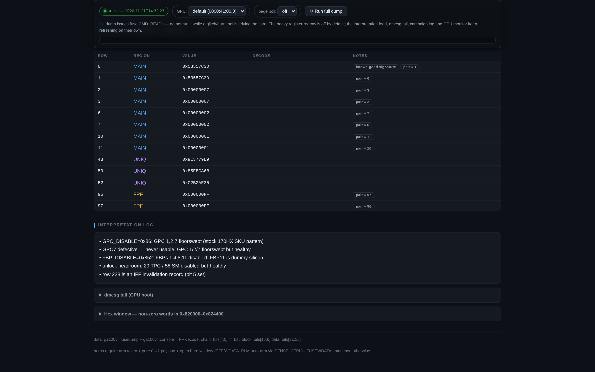
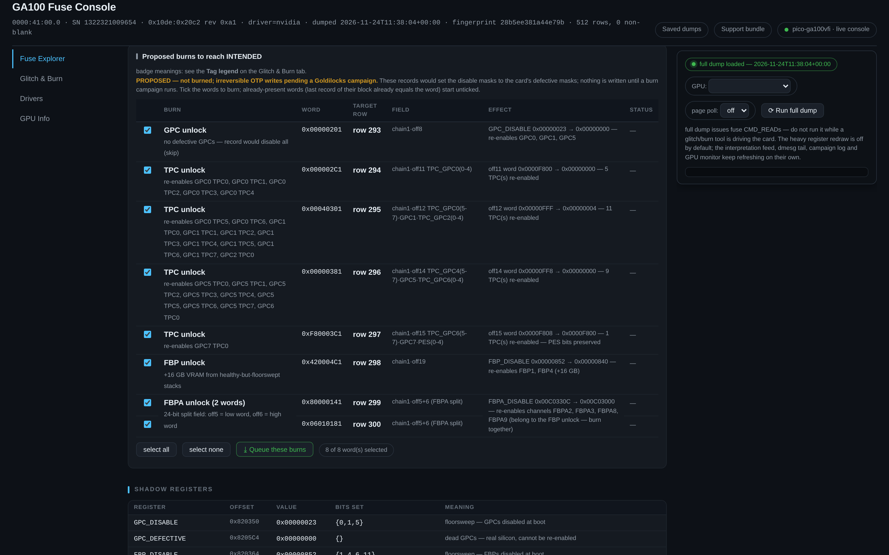
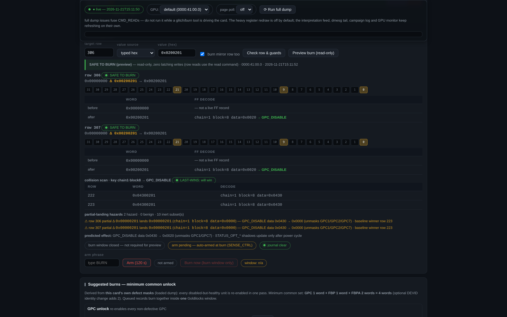
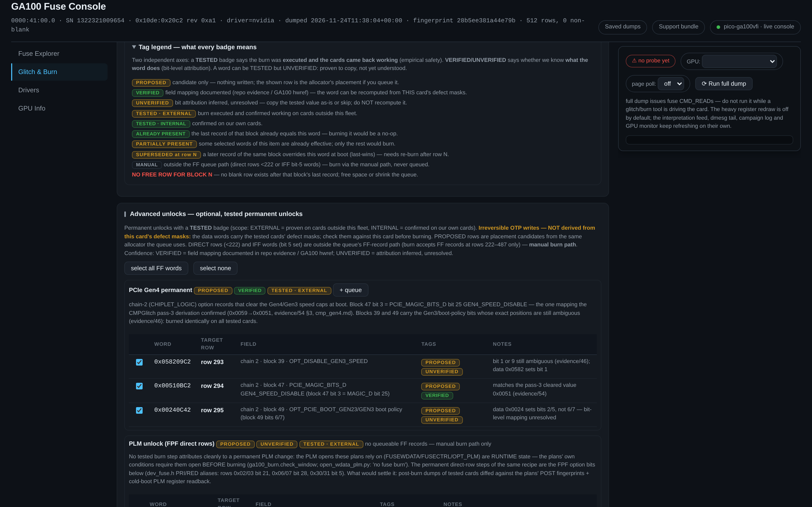

# GA100 Fuse Console — User Guide

> **WARNING — FUSE BURNS ARE PERMANENT AND CAN BRICK YOUR GPU.** Every burn is
> an irreversible one-time-programmable write: a wrong or malformed record can
> leave the card unbootable or unusable **forever** — there is no undo, no
> reflash, no recovery for many mistakes. **It is entirely YOUR responsibility**
> to verify what you burn — use the read-only Burn Preview, the guard checks,
> readbacks and your own research before arming. **The developer accepts NO
> responsibility** for bricked cards, damaged hardware, lost work or any other
> consequence of using this tool. You are modifying your own hardware at your
> own risk.

Operational guide for the Fuse Console (`python3 -m ga100vfi.console`): what every
control does, the end-to-end unlock workflow, and the complete guard
chain. Reference detail (HTTP API, systemd unit, flags) lives in
[CONSOLE.md](CONSOLE.md); this document tells you how to *drive* the tool.
Every behavioral statement here describes the current code.

## 1. What the console is

The console is a self-contained web service (GUI + HTTP API in one
Python process, root, port 8790) for GA100 / CMP 170HX fuse surgery:
live read-only register and fuse viewing, NVVDD voltage-glitch campaigns
driven over an RP2350 Pico, guarded irreversible FF-record burns, driver
control, and GPU status. It refuses — structurally, server-side — every
write path it was not designed to make: probes and dumps are pure
reads, the burn preview cannot latch, and only the burn itself touches
the program hardware. Burns are one-way OTP writes with a finite row
budget, so the UI is built around preview → check → arm → burn → verify.

The console starts and serves **card-less**: with no GA100 in the slot it
shows an honest empty state instead of stale data, and self-detects a
card inserted later on the next poll. Nothing dump-derived is ever
presented as live when it is not — saved data is always labelled with
its source (see the Saved dumps browser below).

Mental model: the card boots locked (`DSOV = 1`). A shallow triple-pulse
NVVDD dip timed off the PEX_RST release edge makes the fuse block
sample itself as unburned — the **Goldilocks window**: `DSOV = 0`,
`CRC_STATUS = 0x55`, privilege masks open. Inside that window the
console **arms** the fuse controller (SENSE restores program enable,
write locks open) and **burns FF records** — chain/block/data words
appended to blank OTP rows, replayed at boot with last-record-per-block
winning — so a new record overrides the factory floorsweep without
touching earlier rows. A **power cycle** then replays the new FF chain:
only after that do the `STATUS_OPT_*` shadows show the unlock.

Dump identity: dumps belong to the **card**, not the slot. Every dump
records the board serial (read from the InfoROM when the driver is
unbound, from `nvidia-smi` when it is bound) and is stored under
`dumps/sn-<serial>/`. The PCIe address is only the transport — after a
card swap the console says `No dump yet for this card (serial X)`
instead of showing the previous card's dump, and the support bundle
labels each dump `current card` or `different card (serial Y)`. Old
dump folders on disk keep working untouched.

## 2. Requirements & launch

- Linux host with the CMP 170HX installed and the Pico on the **same
  host** (`/dev/ttyACM0`): campaigns need Pico serial + PCIe BAR0
  access simultaneously. `nvidia` must be unloaded (and blacklisted)
  before glitching; the Drivers tab does both.
- The `ga100vfi` package importable (`pip install -e host/`), `pyserial`,
  and root (BAR0 via sysfs `resource0`; blacklist writes
  `/etc/modprobe.d`). No auth — trusted network only.

```sh
sudo python3 -m ga100vfi.console --port 8790     # card auto-detected
```

Open `http://<host>:8790`. Flags (`--bdf`, `--state-dir`, `--listen`,
`--ff-*` reserves): see [CONSOLE.md](CONSOLE.md#starting-the-console).
With no card present the console still starts and serves; a card
inserted later is picked up automatically. On a validated GA100 the
console **auto-enables the BAR** (sets `PCI COMMAND` memory-enable if
the kernel left it clear at cold boot) before mapping BAR0, so a
driver-less card is readable without a manual setpci poke; the write
is config-space only, idempotent, and logged.

**Mock mode** (no hardware): `--mock dump.json` serves a recorded dump.
Glitch, standalone burn, burn check and driver ops all refuse
("not available in mock mode"); the read-only **burn preview** is the
one burn-adjacent feature that runs in mock.

**systemd**: unit example in
[CONSOLE.md](CONSOLE.md#systemd-example) — order after `network.target`.
On SIGTERM the service stops any campaign (which reverts the VRM)
before exiting, so an interrupted run never leaves NVVDD low.

## 3. Tab reference

### Fuse Explorer



*Captured from the current console UI in mock mode on the latest code, including the brick-risk warning banner (representative fuse data);
card serial, host name, IP addresses, username and home paths are masked.*

Live pure-read view of the target card. Controls and indicators:

| Control / indicator | Behavior |
|---|---|
| live pill | `● live — <time>` · `⏸ driver bound` (server poller pauses — raw BAR0 reads under GSP can wedge it; unload on Drivers to resume) · `⚠ BAR0 unreadable` (normal mid-glitch) |
| GPU selector | lists **detected** GA100s only (multi-GPU hosts); the effective default carries a `(default)` suffix; an amber banner appears when the configured BDF is absent and the console follows another card |
| page poll | heavy register-grid redraw rate; default **off** — the interpretation feed, dmesg tail, campaign log and GPU monitor refresh regardless, and all pollers pause when the browser tab is hidden |
| ⟳ Run full dump | rows 0–487 via fuse `CMD_READ` + hex window, archived to `<state-dir>/dumps/sn-<serial>/<ts>/` (board-serial-keyed; `bdf-<bdf>/<ts>/` when the serial is unreadable); refused while a campaign runs; when no GA100 is present the button reports `no GA100 present on this host` — it never dumps the pinned `--bdf` of an absent card |
| `Saved dumps` (header button) | opens the history picker `Saved dumps — newest first`: every saved dump of **any** card (serial, dump time, row count, `driver-bound` / `UNVERIFIED` flags, `(current card)` tag); click an entry to browse it; `Close ✕` dismisses |
| empty state | with no dump on screen: `No dump yet for this card (serial X)` (card present, never dumped) or `No GA100 present — nothing live to show.` (card-less boot) + a `Browse saved dumps` button; the dump-derived panels stay hidden until there is real data |
| card-less banner | `⚠ no GA100 present on this host` — insert a card and the console self-detects it on the next poll; endpoints answer their honest error meanwhile |
| saved-dump strip | when the shown dump is not the present card's live state, the dump panels are **dimmed** and labelled: `showing saved dump of card serial X (dumped <ts>)` + `no GA100 present` / `different card present (serial Y)`, or `Browsing saved dump — serial X, dumped <ts>` with a `← Back to current` button while browsing history; the header meta line gains a `SAVED DUMP OF` prefix |
| interpretation feed | register-change diff (`DSOV: 0x1 → 0x0` the moment a glitch lands) |
| topology + state buttons | GPC/FBP floorsweep vs defective masks; `Stock state (this card's factory fuses)` / `Intended (this card's defects)` / `NOW (live)` — see "The three states" below; dead-but-enabled silicon drawn red-hatched; click any unit for a full register audit dialog |
| TPC map | per-GPC SM availability: green enabled, yellow disabled-healthy (unlock headroom), red defective; "after unlock" is the fuse ceiling |
| row table | all rows with region colouring (MAIN/UNIQ/FPF/FF), mirror pairing, FF decode (`chain/iff/block/data` + block names); filter buttons + search; click a row for its bit breakdown |

**The three states.** The topology and TPC-map views render one of three
disable-mask interpretations of the same defective masks:

- `STOCK (this card's factory fuses — first dump seen)` — **this card's
  own** first-saved dump, kept as `dumps/sn-<serial>/stock.json`
  (written once, never overwritten; served by `/api/stock` with its
  `stock_provenance` line). It replaced a hardcoded SKU template: a
  card modified before the console first saw it shows stock = state at
  first sight, and any stock-vs-now difference is a real fuse change.
  With no baseline yet the view falls back to the now state and says
  `no stock baseline recorded yet — this dump is the first record`.
- `INTENDED (this card's defects — everything not dead runs)` — the
  unlock goal: the disable mask equal to this card's own defective
  mask. Never a payload copied from another card.
- `NOW (live registers)` — what the shown dump/poll actually reads.

**Proposed burns to reach INTENDED.** While the unit/TPC view is in the
INTENDED state, a panel below the TPC map lists the burn records that
would close the gap between the live disable masks and the card's
defective masks — as a **table** (`✓ | Burn | Word | Target row | Field |
Effect | Status`; multi-word entries share their Burn/Effect cells).
Every word carries a `PROPOSED` badge and a selection
**checkbox**; the banner states `PROPOSED — not burned; irreversible
OTP writes pending a Goldilocks campaign` and points to the **Tag
legend** on the Glitch & Burn tab for badge meanings. Each word shows its
concrete target row from the same allocator the burn queue uses
(`row N`, `+ mirror N+1` when the mirror checkbox is on — it is OFF by
default) — the proposed row **is**
the row the queue will assign; a word already in the burn queue shows
`in queue — row shown there` instead of a second allocation (one word,
one row). Presence is judged by the replay rule,
not a string match: a word whose block's last live record already
equals it is tagged `ALREADY PRESENT (row N) — no burn needed` and
defaults **unticked**; a word overridden by a later record of its
block is `SUPERSEDED at row N — needs re-burn` and stays ticked.
`select all` / `select none` set every checkbox; the pill shows
`N of M word(s) selected`. **⤓ Queue these burns** enqueues exactly the
selected words through the same path as the Suggested burns card
(shared selection state — both lists always show the same checkboxes).
If a selected word's block has no blank row after its last record the
table says `NO FREE ROW (block b)` and the queue
refuses to start until space frees up. The panel renders only in the
INTENDED state and recomputes on every dump — after a real burn moves
NOW, the next dump shows fewer or no proposals (`no burns proposed —
card already at intended state`).



*Captured from the current console UI in mock mode on the latest code (representative fuse data with one word seeded as already present);
card serial, host name, IP addresses, username and home paths are masked.*

**Driver-bound guarded capture.** While `nvidia` is bound the live BAR0
poller pauses, but fuse capture stays available: the right rail shows
`Fuse capture available (driver bound)` with the age of this card's
last dump (collapsible via `Collapse ▴` / `Expand ▾`). **Capture fuse
dump (driver bound)** opens a consent panel listing every preflight
condition with its read value and expected value; **Capture now** is
disabled until all pass (`fix the failed conditions first`). The
capture is read-only, double-pass, saved serial-keyed with a
`driver_bound` marker, and its result is honestly badged
`UNVERIFIED (driver bound)` — a driver-bound readback cannot be
trusted like an unbound one. Details:
[CONSOLE.md](CONSOLE.md#driver-bound-guarded-capture).

### Glitch & Burn


*Captured from the current console UI in mock mode on the latest code, including the brick-risk warning banner (representative fuse data);
card serial, host name, IP addresses, username and home paths are masked.*

| Card / control | Behavior |
|---|---|
| Target | GPU picker + state pill (`● Goldilocks — glitch window` / `locked (DSOV=1) — glitch first` / `⚠ unreadable`) + serial pill identifying the physical card |
| Burn placement policy | live row map of the FF region (boot FFs · buffer · **burn zone** · SM re-disable reserve · revert tail), budget pill, and a per-row ✓/✗ hint as you type a row. Placement is **per-block last-wins**: each record lands after its own block's last record; the global burn zone is a display heuristic — on an already-burned card it may collapse (`global burn zone empty — last boot FF row N; placement is per-block`) while every blank row after each block's own last record stays usable |
| Burn payload | target row; value **typed hex** or **from dump row** (grabs the value from the loaded dump and shows it decoded for verification — IFF values flagged as refused); `burn mirror row too` checkbox — **OFF by default** (the proven reference recipes burned ONE row per FF record; enable only if you specifically want the redundant pair) |
| Preview burn (read-only) | see below — enabled on row+value alone, no window/arm/token |
| Check row & guards | dry check: current row value, 0→1 purity, placement-policy verdict, window checks, arm-pending bits; enables Burn (with arm + open window) |
| arm phrase + Arm (120 s) | type `BURN`, click Arm → countdown pill `● armed Ns`; wrong phrase → sticky red refusal until you edit the phrase; button disabled while the selected GPU is not Goldilocks (`selected GPU not Goldilocks — glitch first`) |
| Burn payload row ONLY (standalone) | the demoted single-row burn (was "Burn now") — burns ONLY the payload row, never the queue (tooltip says so); enabled only when checked + armed + window open; double confirm; journal-uncertain → explicit ack dialog |
| window pill | the ONE authoritative burn-window verdict from the live poller: `burn window: OPEN` / `burn window: FADING (<failed bits>)` (DSOV still 0, decaying) / `burn window: closed (<failed bits>)` / `burn window: n/a` — same state on the Burn queue card and in the campaign held-window chip |
| Suggested burns | computes the minimum common unlock from this card's own shadow masks (GPC / TPC unlock words — chain1 offs 11–15 that differ from the per-GPC defective masks / FBP / FBPA-pair), rendered as the same table as the Proposed burns panel (`✓ \| Burn \| Word \| Target row \| Field \| Effect \| Status \| + queue`), each word decoded, with its concrete `Target row` (`row N`, `+ mirror N+1` when mirroring is on) from the same allocator the queue uses — queue-aware, and a word already queued shows `in queue — row shown there` (one word, one row); per-word selection checkboxes with LAST-WINS-aware `ALREADY PRESENT` / `SUPERSEDED` marking (already-present words default unticked, shared with the Proposed burns panel); `⤓ Queue all needed records` queues the selected words, `+ queue` a single word, or queue a DEVID A/B pair |
| Advanced unlocks | optional permanent unlocks proven by executed burns with a `TESTED · EXTERNAL` / `TESTED · INTERNAL` badge — see below |
| Tag legend | collapsible card explaining every badge (`PROPOSED`, `VERIFIED`/`UNVERIFIED`, `TESTED · EXTERNAL`/`INTERNAL`, `ALREADY PRESENT`, `PARTIALLY PRESENT`, `SUPERSEDED`, `MANUAL`, `NO FREE ROW`) and the two axes: TESTED = the burn was executed and cards worked; VERIFIED = we know what the word does |
| Burn queue — arm & burn in one action | sits directly under the Glitch campaign card; **⚡ Arm & burn queue (N)** arms and starts the burn campaign in ONE request (`POST /api/burn/queue_start`, no 120 s TTL race; disabled with a one-line reason when queue empty / campaign running / no GPU), **Check queue** previews every queued record read-only and stamps `preview: <verdict>` per row. Records all burn in **one** Goldilocks window, rendered as a table (`# \| Word \| Target row \| Field \| Status \| Via \| action`); while/after a burn campaign the Status column shows the server's per-record result (`VERIFY OK` green / `ALREADY BURNED` amber / `ABORT …` red / `pending` dim); rows assigned per-block last-wins in the safe zone (mirror consumes an even/odd pair) and shown per entry (`row N + mirror N+1`); a typed custom row is reserved before auto-allocation and a row claimed twice blocks the queue (`row(s) N claimed by two records`); a word whose block has no free row shows `NO FREE ROW (block b)`; a force-queued already-present word carries the amber tag `already present — likely no-op (row N)`; server re-validates every row |
| Glitch campaign | v_dip/pulses/pw/gap/delay/max attempts; strategy `fixed` or `adaptive` (3D CRC-guided search over v_dip/delay/pw — the fixed v_dip is ignored); pico port + rescan; mode `classify only` or `burn payload on first Goldilocks`; window dropdown `hold open — no revert` (default) / `auto-revert` |
| ▶ Start / ■ Stop / ⟲ Revert VRM | Revert hands PMBus back, closing a held window (refused while a campaign owns the Pico) |
| stats chips + log | attempts / valid / lost / nack / dsov=0 / goldilocks / burn aborts / `IMAGE VERIFY FAILED — window NOT held` / `campaign ended holding the window — burn window: OPEN` (event + live state); per-shot log lines |

**Check panel semantics.** The top line is `SAFE TO BURN` / `REFUSED`
and keys off the **window checks only** — `DSOV=0`, `CRC_STATUS=0x55`,
loader `0x120060=0`, `FUSECTRL_PLM`/`PRIV_MASK` open, `DEBUGCTRL=0`,
`SWIFF=0`, `IFF_CTRL=0`, `FUSECTRL` idle — rendered green ✓ / red ✗.
`EFP`, `PROGRAM_DIS`, `SBFE`, `WDATA_SECURE`, `FUSEWDATA_PLM` appear as
**amber `arm_pending` rows** ("auto-armed at burn via SENSE_CTRL"):
they read closed outside a burn by design and are opened by the arm
sequence inside the burn itself — they never block the check or burn.


*Captured on a previous build (horizontal-tab chrome). Check needs a live card — the mock console refuses it with an error line, so this
result panel cannot be re-rendered from mock; the shot is kept as-is rather than replaced with a mock error strip.*

**Burn Preview panel** (`Preview burn (read-only)`): a dry-run of the
exact payload that **cannot write** — the server runs it through a card
handle whose every non-`CMD_READ` write raises. It works any time, even
on a cold card and in mock (`CMD_READ` is gated by `FUSECTRL_PLM`, not
`EFP`). It shows:

- **verdict banner**: `SAFE TO BURN` (green) / `WILL BE INERT` (red) /
  `IMPOSSIBLE` (red — the value would clear bits, which OTP cannot do) /
  `ALREADY BURNED` (amber);
- per row (mirror included): **before → Δ → after** words with the
  delta bits highlighted on a bit strip, and both words **decoded** as
  FF records (`chain/block/data` + block names) when in the FF region;
- **collision scan**: every existing record with the same
  `(chain, block)` key and a **LAST-WINS verdict** — green *will win*,
  or red *will LOSE to row N* → the burn would be **inert** (fix: burn a
  later row); a same-key record at exactly a burned row is called out
  as *record already present at this row — re-burn is a no-op/ALREADY
  path*;
- **partial-landing hazards**: every delta subset that, if only it
  latched, would *win* its `(chain, block)` key (a partial at the burned
  row beats every earlier record) with data different from the intent —
  advisory only, never a gate. A subset whose data equals the intent's
  is benign; one a strictly-later record overrides is inert. Effects
  are stated against the burned row's effective winner (baseline named
  in the text), and every burn row — mirror included — is analyzed;
  skipped above 12 delta bits;
- **predicted effect** when decodable (e.g. `GPC_DISABLE data 0x0430 →
  0x0020 (unmasks GPC1/GPC7) · STATUS_OPT_* shadows update only after
  power cycle`);
- a read-only window / arm-pending / journal status strip.



*Captured from the current console UI in mock mode on the latest code, including the brick-risk warning banner (representative fuse data);
card serial, host name, IP addresses, username and home paths are masked.*

After a real `VERIFY OK` burn of the same payload, the burn report adds
the **Predicted vs Actual** block: preview after-word and LAST-WINS
verdict against the post-burn readback and post-burn collision rescan —
any mismatch red. Both artifacts persist in the state dir
(`last-preview.json`, `last-burn.json`).

**Advanced unlocks — optional, tested permanent unlocks.** Below the
Suggested burns card, an optional card lists the permanent unlocks
**proven by executed burns** — PCIe Gen4 permanent, PLM unlock
(reference-recipe FPF direct rows), and the compute unlock (full
floorsweep + SS0/SS1). Read the caveats before touching it:

- **Irreversible OTP writes — NOT derived from this card's defect
  masks.** The data words carry the **tested cards'** defect masks;
  check them against this card before burning. Per-step
  `per-die variant: another tested card burned 0x… (defect-driven)`
  notes name where the tested cards differed.
- Every item carries a **TESTED badge** with its test scope:
  `TESTED · EXTERNAL` (burn executed and confirmed working on cards
  outside this fleet) or `TESTED · INTERNAL` (confirmed on our own
  cards) — an empirical claim: the burn ran and the cards came back
  working. The confidence tag is a **separate axis**:
  `VERIFIED` = field mapping documented in repo evidence / GA100
  hwref; `UNVERIFIED` = attribution inferred, unresolved. A word can
  be TESTED but UNVERIFIED: proven to copy, not yet understood. No
  recipe or card-name provenance text appears in the UI; the full
  tag legend lives on the same tab (see *Tag legend* above).
- FF-record steps are queueable and show concrete `Target row` rows
  from the same allocator as the queue (`+ queue` enqueues the
  selected steps; `select all FF words` / `select none` set them).
  Steps outside the queue's path are badged `MANUAL`: DIRECT rows
  (<222) show `DIRECT row — manual burn path (queue burns FF records
  only)`, IFF words show `IFF word — manual burn path (ff_policy
  refuses bit 5)`.
- Last-wins presence applies here too: items badge
  `ALREADY PRESENT — no burn needed` or `PARTIALLY PRESENT (k/n)`
  against the shown dump.



*Captured from the current console UI in mock mode on the latest code (Glitch & Burn tab; representative fuse data);
card serial, host name, IP addresses, username and home paths are masked.*

### Drivers


*Captured from the current console UI in mock mode on the latest code, including the brick-risk warning banner (representative fuse data);
card serial, host name, IP addresses, username and home paths are masked.*

State cards (bound driver, version, blacklist, loaded modules) +
two-step-confirm actions: **Load nvidia**, **Unload nvidia stack**
(sysfs unbind + `rmmod` in dependency order), **Blacklist nvidia +
nouveau** (writes `/etc/modprobe.d/ga100-fuse-blacklist.conf`; manual
`modprobe` still works), **Remove blacklist**. Glitching requires the
stack unloaded **and** blacklisted.

### GPU Info


*Captured from the current console UI in mock mode on the latest code, including the brick-risk warning banner (representative fuse data);
card serial, host name, IP addresses, username and home paths are masked.*

Per-GPU nvidia-smi grid (auto-refresh 1–10 s or off) + `lspci` link
state + compute apps. Honest banners: `No devices were found` is normal
while the card is GFW-dead; when the driver is unloaded the console
skips nvidia-smi entirely (NVML would auto-load the driver back) and
shows lspci only.

## 4. End-to-end workflow

> **WARNING — FUSE BURNS ARE PERMANENT AND CAN BRICK YOUR GPU.** Every burn is
> an irreversible one-time-programmable write: a wrong or malformed record can
> leave the card unbootable or unusable **forever** — there is no undo, no
> reflash, no recovery for many mistakes. **It is entirely YOUR responsibility**
> to verify what you burn — use the read-only Burn Preview, the guard checks,
> readbacks and your own research before arming. **The developer accepts NO
> responsibility** for bricked cards, damaged hardware, lost work or any other
> consequence of using this tool. You are modifying your own hardware at your
> own risk.

1. **First boot (card-less is fine)**: the console serves with
   `No GA100 present — nothing live to show.`; insert the card and the
   next poll self-detects it. The first full dump you save for a card
   becomes its permanent `STOCK` baseline (`stock.json`, never
   overwritten).
2. **Explore** (read-only): press **⟳ Run full dump**, study topology /
   TPC map / FF rows. Compare the three states (`Stock state …` /
   `Intended …` / `NOW (live)`). `CRC_STATUS == 0x55` = the fuse block
   parses; `DSOV = 1` = locked (normal).
3. **Plan from INTENDED**: switch the unit view to
   `Intended (this card's defects)` and review the **Proposed burns to
   reach INTENDED** panel — every word decoded, concrete target rows,
   already-present words pre-unticked. Tick exactly what you want to
   burn and press **⤓ Queue these burns** (or build the same queue
   from the Suggested burns card on Glitch & Burn — the selection is
   shared). Optionally add Advanced unlocks steps (read their
   caveats above) or custom records.
4. **Prep drivers** (Drivers tab): **Unload nvidia stack**, then
   **Blacklist nvidia + nouveau**. Campaign start refuses while a
   driver is bound.
5. **Campaign** (Glitch & Burn): pick target + pico port; review the
   **Burn queue** table — each entry shows the row it will burn
   (`row N`, `+ mirror N+1` only when the opt-in mirror is on). `fixed` repeats one v_dip; `adaptive`
   runs the 3D CRC-guided search over (v_dip, delay, pw) — recommended
   for an uncharacterised card. Start with mode **classify only** to
   find the window; every shot logs its outcome
   (`under`/`hit`/`over`/`lost`, `<< GOLDILOCKS` on a pass).
6. **Read the verdict**: the window pill flips `burn window: OPEN`,
   the campaign ends with `goldilocks YES` and (default) **holds the
   window open** — no VRM revert — so in-window work is possible.
   Misses/stops/errors always revert; an interrupted run never leaves
   NVVDD low.
7. **Check the row & guards** (single-payload path): expect
   `SAFE TO BURN`, green window bits, amber arm-pending rows, policy
   `OK`. Any edit to row/value/mirror invalidates the check — re-check.
8. **Arm**: type `BURN`, press **Arm (120 s)** — the button stays disabled
   until the selected GPU reads Goldilocks; the token expires in
   120 s.

   

   *Captured from the current console UI in mock mode on the latest code, including the brick-risk warning banner (representative fuse
   data); card serial, host name, IP
   addresses, username and home paths are masked. Shown armed with the
   window verdict `n/a` (mock-served card state); **Burn now** appears
   enabled because the check response is a route-injected live-shaped
   one reporting an open burn window — mock mode refuses the real check
   server-side (correcting the earlier caption, which claimed Burn was
   disabled in this shot; it was not).*
9. **Burn**: either **Burn payload row ONLY (standalone)** (only inside a
   live window; never burns the queue) or — the
   normal path for a queue — **⚡ Arm & burn queue (N)** (one request:
   arm gate + campaign start) or, manually, set campaign mode **burn
   payload on first
   Goldilocks** and start: the burn runs *inside the campaign process*
   on the first hit (the window dies seconds after the loop returns).
   Each record logs `row N: VERIFY OK` (or `ALREADY BURNED`); the
   campaign ends only when **every** record succeeds and, for ≥2
   records, the whole burned image re-reads correctly twice.
10. **Readback + image verify**: `VERIFY OK` = the bits landed.
    `IMAGE VERIFY FAILED` = they did not — the window is **not** held.
    Check the Predicted vs Actual block.
11. **Power cycle** the card (cold boot), then verify on Fuse Explorer:
    `STATUS_OPT_GPC` / `STATUS_OPT_FBP` shadows and the NOW topology
    are the proof the chain took effect. The Proposed burns panel
    recomputes against the new dump — a completed unlock shows
    `no burns proposed — card already at intended state`. Close a held
    window earlier with **⟲ Revert VRM** if you are done in-window.
12. **Verify unlock** under the driver: **Load nvidia**, GPU Info tab —
    SM/VRAM totals should match the fuse ceiling.
13. **Bundle it**: **Support bundle** (header) downloads one tar.gz —
    console logs, dumps, live snapshot, lspci/dmesg, nvidia-smi
    snapshot, interpretation trace, and a manifest pinning the exact
    build (`tool_version`, `tool_git_sha` + `git_sha_source`,
    `tool_fingerprint`) and labelling every dump `current card` /
    `different card (serial Y)`. Attach it when reporting an issue:
    [CONSOLE.md](CONSOLE.md#submitting-a-support-bundle).

**Browsing saved dumps.** The header **Saved dumps** button opens the
history picker (newest first, every card). Picking a dump dims the
dump-derived panels and labels them `Browsing saved dump — serial X,
dumped <ts>` with **← Back to current**, which restores the present
card's own newest saved dump (or the honest empty state). A saved dump
of another card is never shown by default and never masquerades as
live. Saved dumps carry the FF layout with them, so proposed/queue
target rows name exact rows even while browsing with no card present.

## 5. Safeguards against a bad or half burn

Every row below is enforced in the current code (audit with file:line in
the task evidence; `service.py` = `host/ga100vfi/console/service.py`,
`gui.py` = `host/ga100vfi/console/gui.py`).

| Guard | What it prevents | Where enforced |
|---|---|---|
| Typed arm phrase `BURN` | a mis-click burning OTP | client (arm field/button) + server (`arm_api` rejects any other phrase) |
| Server arm token, 120 s TTL | stale intent burning much later | server (`/api/arm` uuid + expiry; `/api/burn` and burn-mode `/api/glitch/start` validate token and expiry) |
| Check bound to the exact payload; sticky arm refusal | checking one payload and burning another; the refusal explanation vanishing on the next tick | client (any row/value/mirror edit clears the check and disables Burn; refusal persists until the phrase is edited) |
| Check-before-burn | burning with no fresh guard verdict | client (Burn disabled until a successful Check) + server (a `/api/burn` without `confirm` is only a dry check) |
| Burn preview structurally read-only | a "what-if" panel that surprises you with writes | server (`ReadOnlyFuse`/`MockFuseReader` raise on every write outside the `CMD_READ` path) |
| Last-wins collision verdict (`WILL BE INERT`) | burning a record a later existing record already overrides — a wasted row | server (preview collision scan over the FF pool; advisory — the burn itself is not blocked) |
| Last-wins-aware selection defaults | wasting a row re-burning a word that is already effective (last record of its block equals it → `ALREADY PRESENT`, default unticked); silently skipping a word a later record overrides (`SUPERSEDED` stays ticked — re-burn is the fix) | client (shared selection state across Proposed burns / Suggested burns / Advanced unlocks; force-queued present words tagged `already present — likely no-op (row N)`) |
| Partial-landing hazard list | a subset of the delta latching and making a *wrong* record authoritative (a partial at the burned row wins over every earlier record) | server (preview enumerates delta subsets per burn row, mirror included, capped at 12 bits; advisory — never a gate) |
| `IMPOSSIBLE` 1→0 refusal | planning a value that clears bits (OTP can only add) | server (preview verdict + `burn_api`/`glitch_start` pure-0→1 rejection) |
| `ALREADY BURNED` detection | re-burning an already-latched row | server (preview; `burn_execute` returns success with zero latching writes) |
| Goldilocks window gate | a standalone burn outside a live window | client (Burn disabled unless the window verdict is open) + server (`burn_execute` ABORTs on the window checks) |
| Minimal burn-window bits | programming while DSOV/CRC/loader/PLMs/DEBUG/SWIFF/IFF/idle say the controller is not safe | server (`burn_window`, mirrors `ga100_burn.check_window`; the poller's verdict is the same read-only check) |
| SENSE arm sequence | programming with EFP off or the write locks closed | server (`arm_window`: SENSE ≤1 per attempt, window re-check after SENSE is fatal on failure, `PROGRAM_DIS==0`, `WDATA_SECURE=0`, `SBFE=0`, `FUSEWDATA_PLM` open) |
| EN=1 raise with read-back | pulsing a program command while FUSE_EN is off | server (`burn_execute` writes `EN_SW_OVERRIDE=1`, reads it back, ABORTs on mismatch — no retry) |
| GPIO19 preflight + TRIGGER bracket with restore on every exit | strobing through a wrong mux/inversion/latch; leaving the strobe high after a failure | server + hardware (`burn_execute` preflight ABORTs before any write; masked `GPIO`/`TRIGGER` writes with latch read-back and bit0 poll; `finally` drives GPIO low, re-pulses TRIGGER and restores saved GPIO + EN on every path) |
| Driver-unbound refusal | fuse/BAR0 writes under `nvidia` (corrupts GSP boots) | server (`burn_execute` ABORTs before any write; `glitch_start` refuses; the driver-bound capture path is read-only and preflight-gated) |
| Pure 0→1 payload check | a value that would clear burned bits | server (`burn_api`, `glitch_start` record validation, `burn_check` purity) |
| Row-state (old-value) match | burning against a stale read of the row | server (`burn_execute` aborts unless the row reads exactly the expected old value) |
| `ff_policy` placement | overwriting boot FFs, burning the boot-FF buffer, spending the SM re-disable reserve or the revert tail, IFF (bit-5) values that truncate the FF pool; placement is **per-block last-wins** — a new record must land after its own block's last record | server (hard-enforced in `burn_api` and `glitch_start`; reported by `burn_check`) |
| Mirror-row pairing | a mirror pair diverging | server (burn burns the mirror after the primary; policy checks both rows; pair gets the 2-pass image verify) |
| fsync'd journal + uncertain-state lockout | burning blindly after a crash mid-`CMD_WRITE` | server (`command_may_be_issued` fsync'd **before** EN can latch; unresolved entry ABORTs with `journal_uncertain` until `ack_uncertain: true`; GUI shows an explicit confirm) |
| Campaign success = every record `VERIFY OK`/`ALREADY BURNED` | declaring victory on a partial burn | server (`burn_campaign_final`; an ABORT is logged, not final — attempts keep firing, window not held) |
| 2-pass image verify (≥2 records) | a multi-record burn whose rows individually verify but whose image is wrong | server (`burn_image_verify` re-reads every burned row twice; mismatch → `IMAGE VERIFY FAILED`, window not held, no success claim) |
| Predicted-vs-actual after burn | the plan silently diverging from what latched | server (`after_state` re-scan) + client (Predicted vs Actual table, mismatch red) |
| No-retry policy | repeated latching attempts after an ambiguous failure | server (every window/arm/latch/verify failure ABORTs; SENSE at most once; nothing re-fires) |
| Host / Origin checks | DNS rebinding and cross-site POSTs driving your rig | server (403 on foreign `Host` or mismatched browser `Origin`) |
| Mock refusals | trusting mock as hardware | server (burn, burn check, glitch start, driver ops refuse; preview is the deliberate exception) |
| v_dip range 200–500 mV | a typo commanding ~3.5 V onto a ~0.7 V rail | server (`glitch_start` refuses outside range) |
| card_lock / campaign-running refusals | concurrent card access (dump vs burn vs campaign) racing each other | server (busy errors instead of interleaved fuse commands) |
| sysfs GA100 identity gate before any BAR0 mmap/write | fuse `CMD_READ` writes landing on whatever function occupies a pinned BDF after a card swap (an AMD dummy function took writes and rebooted the host, 2026-11-23) | server (`fusedump.require_ga100` via `resolve_target` on every BAR0-touching path: full dump, guarded capture + preflight, burn / check / preview, arm, glitch start, FF layout; `valid_bdf` accepts detected cards only; dump endpoints answer 409 `no GA100 present on this host` when none is) |
| BAR auto-enable behind the identity gate | garbage BAR0 reads when the kernel left memory-enable clear at cold boot; config-space pokes on non-GA100 functions | server (`require_ga100`-validated devices only; sets `PCI COMMAND` bit 1 idempotently, one log line per write; failures keep the honest `BAR0 unreadable` path) |
| Driver-bound capture preflight | trusting fuse reads taken under `nvidia`, or capturing while the controller is busy | server + client (`/api/bound_dump/preflight` condition list gates `Capture now`; capture is read-only, double-pass, saved `driver_bound` + `verified: false` and badged `UNVERIFIED (driver bound)`) |
| serial-keyed dump identity | a new card silently inheriting the old card's dump history because it sits in the same slot | server + UI (dumps stored and matched under `sn-<serial>`; last-dump age filtered by serial; bundle manifest labels each dump `current card` / `different card (serial Y)`) |
| stock baseline written once | a later (already-modified) dump silently redefining the card's factory state | server (`dumps/sn-<serial>/stock.json` created `O_EXCL` by the first full dump only, never overwritten; guarded captures never seed it) |

## 6. Deciding a successful unlock — assistance features

| Feature | Where | Good reading | Bad reading |
|---|---|---|---|
| Live change feed | Fuse Explorer, activity feed | `status.DSOV: 0x1 → 0x0` the moment a glitch lands | no change across many shots (window never opened) |
| Three-state topology | Fuse Explorer, state buttons | INTENDED shows every non-defective unit on; STOCK-vs-NOW difference = a real fuse change | `no stock baseline recorded yet` (stock view = now view); `ON!` on a dead unit (boots dead silicon) |
| Proposed burns table | Fuse Explorer, INTENDED state | concrete `row N` per word in the `Target row` column (`+ mirror N+1` only with the opt-in mirror); already-present words pre-unticked; after a completed unlock: `no burns proposed — card already at intended state` | `NO FREE ROW (block b)`; `SUPERSEDED at row N — needs re-burn` |
| Decoded FF records | Explorer row table + burn payload decode line | `chain 1 · block 19 · FBP_DISABLE` | `IFF — REFUSED (bit 5 set)` in a proposed value |
| Burn Preview | Glitch & Burn → Preview burn (read-only) | `SAFE TO BURN`, LAST-WINS *will win*, zero hazards, predicted effect matches intent | `WILL BE INERT` (lose to a later row), `IMPOSSIBLE`, amber hazard lines |
| Advanced unlocks badges | Glitch & Burn → Advanced unlocks | `TESTED · EXTERNAL`/`INTERNAL` + `VERIFIED` step whose tested values match this card's silicon | `UNVERIFIED` step, `PARTIALLY PRESENT (k/n)`, `MANUAL` direct rows (outside the queue path) |
| Window pill + `window_ok` | Glitch & Burn pill, from the poller | `burn window: OPEN` | `burn window: closed (CRC_STATUS)` names the failing bits (`FADING` when DSOV is still 0) |
| Classify verdicts | campaign log per shot; target pill | `<< GOLDILOCKS` (all five checks: dsov_zero, fpf_readable, dsov_settable, priv_mask_open, crc_valid) | `under`/`over`/`lost` lines; `hit` = DSOV cleared but another check failed |
| Campaign log + verdict | Glitch & Burn log + stats chips + `result` | `goldilocks`, `campaign ended holding the window`, every `row N: VERIFY OK` | `exhausted`/`stopped`, `burn aborts` chip, `IMAGE VERIFY FAILED — window NOT held` |
| `goldilocks.jsonl` | `<state-dir>/goldilocks.jsonl` | one JSON line per hit with the winning profile — replayable with `attempt` / `campaign --v-dip` | no line = no hit was ever real |
| Readback `VERIFY OK` | burn report / campaign log | `VERIFY OK` (bit-exact readback with EN cleared) | `VERIFY FAIL — readback does not match` |
| Predicted vs Actual | burn report after `VERIFY OK` (needs a prior Preview of the same payload) | both rows ✓ on readback and last-wins | any ✗ MISMATCH row — the image is not what you planned |
| IMAGE VERIFY | campaign chips / mirror-pair burn report | absent (only ≥2-record burns run it, and silence = pass) | red `IMAGE VERIFY FAILED` — STOP, see §7 |
| GPU Info tab | GPU Info | after driver load: expected SM count / 80 GB, link at full gen/width | `No devices were found` after a burn = card not booting clean |
| Journal history | `<state-dir>/burn_journal.jsonl` | every `command_may_be_issued` followed by its `verified` | a trailing unresolved `command_may_be_issued` = uncertain state |
| Support bundle manifest | header **Support bundle** | `tool_version` / `tool_git_sha` / `tool_fingerprint` pin the exact build; every dump labelled `current card` / `different card (serial Y)` | a `git sha unavailable` warning — match the build by fingerprint against the repo |

## 7. Failure modes & recovery

- **Budget exhausted** (`result: exhausted`): no Goldilocks in
  `max_attempts`. The VRM is reverted automatically; the card is
  unchanged. Re-run (adaptive mode benefits from the accumulated
  model), or nudge `v_dip`/`delay`/`pw`.
- **No free row for a block** (`NO FREE ROW FOR BLOCK b`): that block's
  records already reach the end of its usable space — the queue refuses
  to start until space frees up. Placement is per-block: other blocks'
  blank rows stay usable; shrinking the queue (deselecting words) may
  be all it takes.
- **Window closed mid-burn**: the burn ABORTs on the window/arm checks
  (`ABORT — guard failure (no Goldilocks window)`). In a campaign this
  is *not* final — attempts keep firing and the next Goldilocks
  re-burns; rows already latched return `ALREADY BURNED` and count as
  success, so a mirror pair aborted halfway completes. Standalone:
  re-glitch, re-check, re-arm.
- **Journal lockout** (`uncertain burn state — resolve journal`): a
  previous burn died between `command_may_be_issued` and `verified` —
  the write may have latched without a readback. Inspect
  `burn_journal.jsonl` and a fresh dump; proceed only with the explicit
  `ack_uncertain` confirm.
- **Partial burn (mirror pair)**: primary `VERIFY OK`, mirror ABORT/FAIL
  → the pair is half-burned. Re-run the same payload: the burned half
  reports `ALREADY BURNED` (zero latching writes) and the pair finishes;
  the 2-pass image verify then guards the whole.
- **`IMAGE VERIFY FAILED`**: the burned rows do not match the intended
  image on two re-reads — the campaign does **not** hold the window and
  makes no success claim. **STOP — do not retry blindly.** Per the
  reference burner's doctrine (`ga100_burn.py`: "OTP readback mismatch
  after row N; STOP, no retry" / "Do not retry. Return the journal and
  a fresh dump for diagnosis"): keep the journal, take a fresh full
  dump, and diagnose before spending more rows.

## 8. Glossary

| Term | Meaning |
|---|---|
| DSOV | `0x820084` fuse-block software-override status: `1` = factory-locked (normal boot), `0` = the glitch worked and shadows are live. |
| EFP | Enable Fuse Program (`0x820078`): program-enable latch; reads 0 outside a burn and is restored by SENSE_CTRL at arm time. |
| FF record | A "fuseless-fuse" chain/block/data word in rows 222–487: `chain = bits[4:0]`, `iff = bit 5`, `block = bits[15:6]`, `data = bits[31:16]`. Replayed at boot; the last record per (chain, block) wins. |
| Per-block last-wins | Placement and presence are judged per FF **block**: a new record must land after the last row holding a record of its own block, and a word is effective only when its block's last record equals it. This is why already-burned cards keep free rows and why `SUPERSEDED` words need a later re-burn. |
| Goldilocks | The post-glitch state where the fuse block is unlocked but intact: `DSOV = 0`, `CRC_STATUS = 0x55`, PLMs open, FPF readable — deep enough to unlock, shallow enough to keep the CRC. |
| SENSE | `CMD_SENSE` (`FUSECTRL = 3`): controller command that re-senses the control fuses and restores program enable inside the window. |
| Mirror row | Optional even/odd row pair (row N and its neighbour) for an FF record — OFF by default: the proven reference recipes burned ONE row per FF record. A half-burned pair is the classic partial-burn failure. |
| Boot FF | The FF records the card shipped with (rows up to `last_occupied`); the policy keeps a buffer after them and never burns on top of them. |
| STOCK / INTENDED / NOW | The three topology/TPC views: the card's own first-saved baseline (`stock.json`), the unlock goal (disable mask = defective mask), and the live registers. |
| Proposed burns | The INTENDED-state panel's record list to reach INTENDED — proposals, not writes; queueing them is the user's decision. |
| TESTED · EXTERNAL / INTERNAL | Advanced-unlock badge: the burn was **executed and the cards came back working** (empirical) — on cards outside this fleet (EXTERNAL) or on our own cards (INTERNAL). The data words carry the *tested* cards' defect masks. |
| VERIFIED / UNVERIFIED | Bit-level attribution axis, independent of TESTED: field mapping documented in repo evidence / GA100 hwref vs attribution inferred, unresolved. A word can be TESTED but UNVERIFIED — proven to copy, not yet understood. |
| PLM | Privilege/Lock Mask (`FUSECTRL_PLM`, `PRIV_MASK`, `FUSEWDATA_PLM`): open (`0xFFFFFFFF`) = the path is writable; closed = reads/writes are gated. |
| CRC 0x55 | `CRC_STATUS == 0x55`: the fuse block parsed cleanly — the integrity half of the Goldilocks check. |
| NVVDD | The GPU core rail the Pico dips via PMBus (MP2888B); the glitch is a timed dip of this rail. |
| PEX_RST | PCIe fundamental reset; its release edge is `t = 0` for the glitch timeline. Never driven high by the tooling. |
| Delta | `value & ~current` — the bits actually programmed. The burn writes the delta to `FUSEWDATA`, not the full word. |

---

*Screenshot provenance: all console screenshots in this repo were
captured from the current (v35) console UI running in mock mode (a
recorded, representative fuse dump served to the UI — no burns, no bench
access during capture). The Proposed burns, Advanced unlocks
and Saved dumps shots were captured from the current build's mock
console with placeholder serials (all-zeros / all-ones / all-twos) and
one word seeded already-present to show the `ALREADY PRESENT` badge;
the check-panel shot predates the current
chrome (see its caption). Card serial, host name, IP addresses,
username and home paths are masked throughout.*
