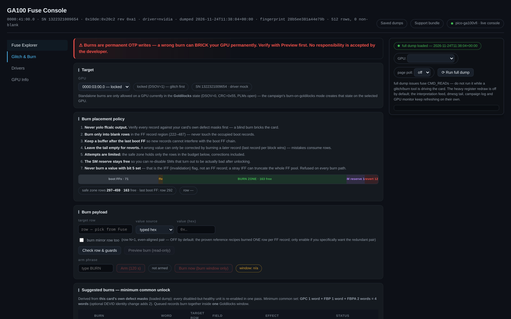
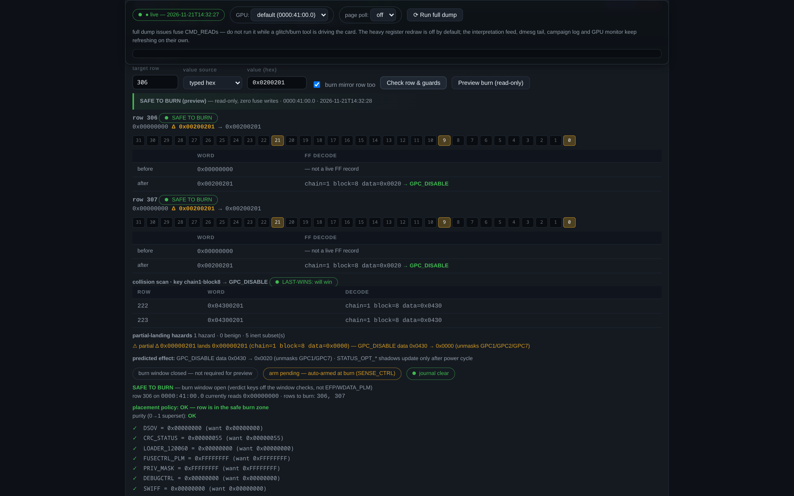
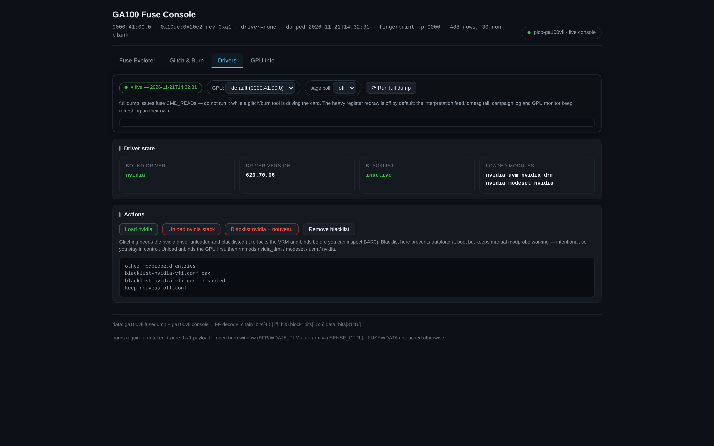
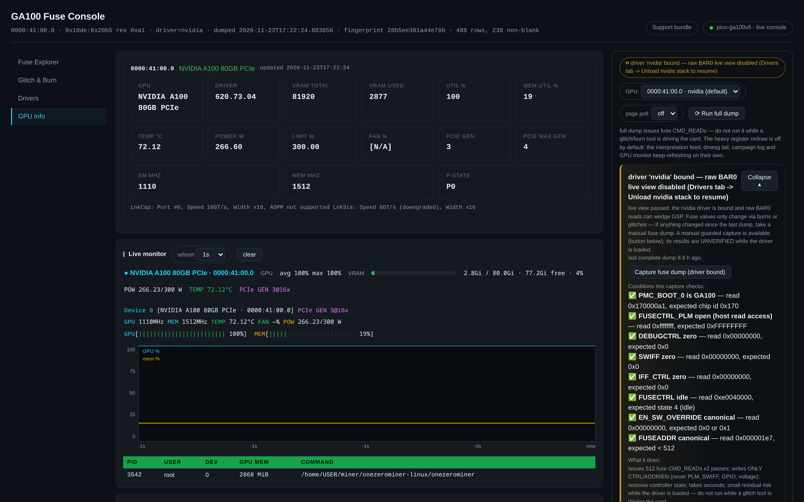
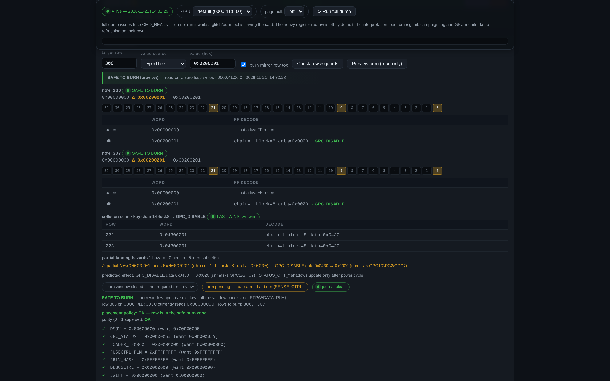

# GA100 Fuse Console — User Guide

Operational guide for the Fuse Console (`ga100vfi console`): what every
control does, the end-to-end unlock workflow, and the complete guard
chain. Reference detail (HTTP API, systemd unit, flags) lives in
[CONSOLE.md](CONSOLE.md); this document tells you how to *drive* the tool.
Every behavioral statement here describes the current code.

## 1. What the console is

The console is a self-contained web service (GUI + HTTP API in one
Python process, root, port 8790) for GA100 / CMP 170HX fuse surgery:
live read-only register and fuse viewing, NVVDD voltage-glitch campaigns
driven over an RP2350 Pico, guarded irreversible FF-record burns, driver
control, and GPU status. It refuses — structurally, server-side — every
write path it was not designed to make: probes and dumps are pure
reads, the burn preview cannot latch, and only the burn itself touches
the program hardware. Burns are one-way OTP writes with a finite row
budget, so the UI is built around preview → check → arm → burn → verify.

Mental model: the card boots locked (`DSOV = 1`). A shallow triple-pulse
NVVDD dip timed off the `PEX_RST` release edge makes the fuse block
sample itself as unburned — the **Goldilocks window**: `DSOV = 0`,
`CRC_STATUS = 0x55`, privilege masks open. Inside that window the
console **arms** the fuse controller (SENSE restores program enable,
write locks open) and **burns FF records** — chain/block/data words
appended to blank OTP rows, replayed at boot with last-record-per-block
winning — so a new record overrides the factory floorsweep without
touching earlier rows. A **power cycle** then replays the new FF chain:
only after that do the `STATUS_OPT_*` shadows show the unlock.

## 2. Requirements & launch

- Linux host with the CMP 170HX installed and the Pico on the **same
  host** (`/dev/ttyACM0`): campaigns need Pico serial + PCIe BAR0
  access simultaneously. `nvidia` must be unloaded (and blacklisted)
  before glitching; the Drivers tab does both.
- The `ga100vfi` package importable (`pip install -e host/`), `pyserial`,
  and root (BAR0 via sysfs `resource0`; blacklist writes
  `/etc/modprobe.d`). No auth — trusted network only.

```sh
sudo python3 -m ga100vfi console --port 8790     # card auto-detected
```

Open `http://<host>:8790`. Flags (`--bdf`, `--state-dir`, `--listen`,
`--ff-*` reserves): see [CONSOLE.md](CONSOLE.md#starting-the-console).

**Mock mode** (no hardware): `--mock dump.json` serves a recorded dump.
Glitch, standalone burn, burn check and driver ops all refuse
("not available in mock mode"); the read-only **burn preview** is the
one burn-adjacent feature that runs in mock.

**systemd**: unit example in
[CONSOLE.md](CONSOLE.md#systemd-example) — order after `network.target`.
On SIGTERM the service stops any campaign (which reverts the VRM)
before exiting, so an interrupted run never leaves NVVDD low.

## 3. Tab reference

### Fuse Explorer


*Captured on a live CMP 170HX bench rig; card serial, host name, IP
addresses, username and home paths are masked.*

Live pure-read view of the target card. Controls and indicators:

| Control / indicator | Behavior |
|---|---|
| live pill | `● live — <time>` · `⏸ driver bound` (server poller pauses — raw BAR0 reads under GSP can wedge it; unload on Drivers to resume) · `⚠ BAR0 unreadable` (normal mid-glitch) |
| GPU selector | pick which GA100 the Explorer watches (multi-GPU hosts) |
| page poll | heavy register-grid redraw rate; default **off** — the interpretation feed, dmesg tail, campaign log and GPU monitor refresh regardless, and all pollers pause when the browser tab is hidden |
| ⟳ Run full dump | rows 0–487 via fuse `CMD_READ` + hex window, archived to `<state-dir>/dumps/<ts>/`; refused while a campaign runs |
| interpretation feed | register-change diff (`DSOV: 0x1 → 0x0` the moment a glitch lands) |
| topology + state buttons | GPC/FBP floorsweep vs defective masks; `Pre-glitch reference` / `Intended (this card's defects)` / `NOW (live)`; dead-but-enabled silicon drawn red-hatched; click any unit for a full register audit dialog |
| TPC map | per-GPC SM availability: green enabled, yellow disabled-healthy (unlock headroom), red defective; "after unlock" is the fuse ceiling |
| row table | all rows with region colouring (MAIN/UNIQ/FPF/FF), mirror pairing, FF decode (`chain/iff/block/data` + block names); filter buttons + search; click a row for its bit breakdown |

### Glitch & Burn



*Captured on a live CMP 170HX bench rig; card serial, host name, IP
addresses, username and home paths are masked.*

| Card / control | Behavior |
|---|---|
| Target | GPU picker + state pill (`● Goldilocks — glitch window` / `locked (DSOV=1) — glitch first` / `⚠ unreadable`) + serial pill identifying the physical card |
| Burn placement policy | live row map of the FF region (boot FFs · buffer · **burn zone** · SM re-disable reserve · revert tail), budget pill, and a per-row ✓/✗ hint as you type a row |
| Burn payload | target row; value **typed hex** or **from dump row** (grabs the value from the loaded dump and shows it decoded for verification — IFF values flagged as refused); `burn mirror row too` checkbox |
| Preview burn (read-only) | see below — enabled on row+value alone, no window/arm/token |
| Check row & guards | dry check: current row value, 0→1 purity, placement-policy verdict, window checks, arm-pending bits; enables Burn (with arm + open window) |
| arm phrase + Arm (120 s) | type `BURN`, click Arm → countdown pill `● armed Ns`; wrong phrase → sticky red refusal until you edit the phrase |
| Burn now | enabled only when checked + armed + window open; double confirm; journal-uncertain → explicit ack dialog |
| window pill | read-only burn-window verdict from the poller: `● burn window open` / `burn window closed (<failed bits>)` / `window: n/a` |
| Suggested burns | computes the minimum common unlock from this card's own shadow masks (GPC / FBP / FBPA-pair), each word decoded, `ALREADY IN DUMP` tagged; queue all or queue a DEVID A/B pair |
| Burn queue | records that all burn in **one** Goldilocks window; rows auto-assigned ascending in the safe zone (mirror consumes an even/odd pair); server re-validates every row |
| Glitch campaign | v_dip/pulses/pw/gap/delay/max attempts; strategy `fixed` or `adaptive` (3D CRC-guided search over v_dip/delay/pw — the fixed v_dip is ignored); pico port + rescan; mode `classify only` or `burn payload on first Goldilocks`; window dropdown `hold open — no revert` (default) / `auto-revert` |
| ▶ Start / ■ Stop / ⟲ Revert VRM | Revert hands PMBus back, closing a held window (refused while a campaign owns the Pico) |
| stats chips + log | attempts / valid / lost / nack / dsov=0 / goldilocks / burn aborts / `IMAGE VERIFY FAILED — window NOT held` / `window HELD open`; per-shot log lines |

**Check panel semantics.** The top line is `SAFE TO BURN` / `REFUSED`
and keys off the **window checks only** — `DSOV=0`, `CRC_STATUS=0x55`,
loader `0x120060=0`, `FUSECTRL_PLM`/`PRIV_MASK` open, `DEBUGCTRL=0`,
`SWIFF=0`, `IFF_CTRL=0`, `FUSECTRL` idle — rendered green ✓ / red ✗.
`EFP`, `PROGRAM_DIS`, `SBFE`, `WDATA_SECURE`, `FUSEWDATA_PLM` appear as
**amber `arm_pending` rows** ("auto-armed at burn via SENSE_CTRL"):
they read closed outside a burn by design and are opened by the arm
sequence inside the burn itself — they never block the check or burn.



*Captured on a live CMP 170HX bench rig; card serial, host name, IP
addresses, username and home paths are masked.*

**Burn Preview panel** (`Preview burn (read-only)`): a dry-run of the
exact payload that **cannot write** — the server runs it through a card
handle whose every non-`CMD_READ` write raises. It works any time, even
on a cold card and in mock (`CMD_READ` is gated by `FUSECTRL_PLM`, not
`EFP`). It shows:

- **verdict banner**: `SAFE TO BURN` (green) / `WILL BE INERT` (red) /
  `IMPOSSIBLE` (red — the value would clear bits, which OTP cannot do) /
  `ALREADY BURNED` (amber);
- per row (mirror included): **before → Δ → after** words with the
  delta bits highlighted on a bit strip, and both words **decoded** as
  FF records (`chain/block/data` + block names) when in the FF region;
- **collision scan**: every existing record with the same
  `(chain, block)` key and a **LAST-WINS verdict** — green *will win*,
  or red *will LOSE to row N* → the burn would be **inert** (fix: burn a
  later row); a same-key record at exactly a burned row is called out
  as *record already present at this row — re-burn is a no-op/ALREADY
  path*;
- **partial-landing hazards**: every delta subset that, if only it
  latched, would *win* its `(chain, block)` key (a partial at the burned
  row beats every earlier record) with data different from the intent —
  advisory only, never a gate. A subset whose data equals the intent's
  is benign; one a strictly-later record overrides is inert. Effects
  are stated against the burned row's effective winner (baseline named
  in the text), and every burn row — mirror included — is analyzed;
  skipped above 12 delta bits;
- **predicted effect** when decodable (e.g. `GPC_DISABLE data 0x0430 →
  0x0020 (unmasks GPC1/GPC7) · STATUS_OPT_* shadows update only after
  power cycle`);
- a read-only window / arm-pending / journal status strip.


*Captured on a live CMP 170HX bench rig; card serial, host name, IP
addresses, username and home paths are masked.*

After a real `VERIFY OK` burn of the same payload, the burn report adds
the **Predicted vs Actual** block: preview after-word and LAST-WINS
verdict against the post-burn readback and post-burn collision rescan —
any mismatch red. Both artifacts persist in the state dir
(`last-preview.json`, `last-burn.json`).

### Drivers



*Captured on a live CMP 170HX bench rig; card serial, host name, IP
addresses, username and home paths are masked.*

State cards (bound driver, version, blacklist, loaded modules) +
two-step-confirm actions: **Load nvidia**, **Unload nvidia stack**
(sysfs unbind + `rmmod` in dependency order), **Blacklist nvidia +
nouveau** (writes `/etc/modprobe.d/ga100-fuse-blacklist.conf`; manual
`modprobe` still works), **Remove blacklist**. Glitching requires the
stack unloaded **and** blacklisted.

### GPU Info



*Captured on a live CMP 170HX bench rig; card serial, host name, IP
addresses, username and home paths are masked.*

Per-GPU nvidia-smi grid (auto-refresh 1–10 s or off) + `lspci` link
state + compute apps. Honest banners: `No devices were found` is normal
while the card is GFW-dead; when the driver is unloaded the console
skips nvidia-smi entirely (NVML would auto-load the driver back) and
shows lspci only.

## 4. End-to-end workflow

1. **Explore** (read-only): open the console, press **⟳ Run full dump**,
   study topology / TPC map / FF rows. `CRC_STATUS == 0x55` = the fuse
   block parses; `DSOV = 1` = locked (normal).
2. **Prep drivers** (Drivers tab): **Unload nvidia stack**, then
   **Blacklist nvidia + nouveau**. Campaign start refuses while a
   driver is bound.
3. **Campaign** (Glitch & Burn): pick target + pico port. `fixed`
   repeats one v_dip; `adaptive` runs the 3D CRC-guided search over
   (v_dip, delay, pw) — recommended for an uncharacterised card. Start
   with mode **classify only** to find the window; every shot logs its
   outcome (`under`/`hit`/`over`/`lost`, `<< GOLDILOCKS` on a pass).
4. **Read the verdict**: the window pill flips `● burn window open`,
   the campaign ends with `goldilocks YES` and (default) **holds the
   window open** — no VRM revert — so in-window work is possible.
   Misses/stops/errors always revert; an interrupted run never leaves
   NVVDD low.
5. **Plan the payload**: use **Suggested burns** (derived from *this
   card's* defect masks — never a payload copied from another card) or
   type a record; queue records for a one-window multi-burn.
6. **Check the row & guards**: expect `SAFE TO BURN`, green window
   bits, amber arm-pending rows, policy `OK`. Any edit to row/value/
   mirror invalidates the check — re-check.
7. **Arm**: type `BURN`, press **Arm (120 s)**; the token expires in
   120 s.

   

   *Captured on a live CMP 170HX bench rig; card serial, host name, IP
   addresses, username and home paths are masked. Shown armed with the
   window verdict `n/a` (mock-served card state), so Burn now is
   disabled — it enables only with a live open window.*
8. **Burn**: either **Burn now** (only inside a live window) or — the
   normal path — set campaign mode **burn payload on first Goldilocks**
   and start: the burn runs *inside the campaign process* on the first
   hit (the window dies seconds after the loop returns). Each record
   logs `row N: VERIFY OK` (or `ALREADY BURNED`); the campaign ends
   only when **every** record succeeds and, for ≥2 records, the whole
   burned image re-reads correctly twice.
9. **Readback + image verify**: `VERIFY OK` = the bits landed.
   `IMAGE VERIFY FAILED` = they did not — the window is **not** held.
   Check the Predicted vs Actual block.
10. **Power cycle** the card (cold boot), then verify on Fuse Explorer:
    `STATUS_OPT_GPC` / `STATUS_OPT_FBP` shadows and the NOW topology
    are the proof the chain took effect. Close a held window earlier
    with **⟲ Revert VRM** if you are done in-window.
11. **Verify unlock** under the driver: **Load nvidia**, GPU Info tab —
    SM/VRAM totals should match the fuse ceiling.

## 5. Safeguards against a bad or half burn

Every row below is enforced in the current code (audit with file:line in
the task evidence; `service.py` = `host/ga100vfi/console/service.py`,
`gui.py` = `host/ga100vfi/console/gui.py`).

| Guard | What it prevents | Where enforced |
|---|---|---|
| Typed arm phrase `BURN` | a mis-click burning OTP | client (arm field/button) + server (`arm_api` rejects any other phrase) |
| Server arm token, 120 s TTL | stale intent burning much later | server (`/api/arm` uuid + expiry; `/api/burn` and burn-mode `/api/glitch/start` validate token and expiry) |
| Check bound to the exact payload; sticky arm refusal | checking one payload and burning another; the refusal explanation vanishing on the next tick | client (any row/value/mirror edit clears the check and disables Burn; refusal persists until the phrase is edited) |
| Check-before-burn | burning with no fresh guard verdict | client (Burn disabled until a successful Check) + server (a `/api/burn` without `confirm` is only a dry check) |
| Burn preview structurally read-only | a "what-if" panel that surprises you with writes | server (`ReadOnlyFuse`/`MockFuseReader` raise on every write outside the `CMD_READ` path) |
| Last-wins collision verdict (`WILL BE INERT`) | burning a record a later existing record already overrides — a wasted row | server (preview collision scan over the FF pool; advisory — the burn itself is not blocked) |
| Partial-landing hazard list | a subset of the delta latching and making a *wrong* record authoritative (a partial at the burned row wins over every earlier record) | server (preview enumerates delta subsets per burn row, mirror included, capped at 12 bits; advisory — never a gate) |
| `IMPOSSIBLE` 1→0 refusal | planning a value that clears bits (OTP can only add) | server (preview verdict + `burn_api`/`glitch_start` pure-0→1 rejection) |
| `ALREADY BURNED` detection | re-burning an already-latched row | server (preview; `burn_execute` returns success with zero latching writes) |
| Goldilocks window gate | a standalone burn outside a live window | client (Burn disabled unless the window verdict is open) + server (`burn_execute` ABORTs on the window checks) |
| Minimal burn-window bits | programming while DSOV/CRC/loader/PLMs/DEBUG/SWIFF/IFF/idle say the controller is not safe | server (`burn_window`, mirrors `ga100_burn.check_window`; the poller's verdict is the same read-only check) |
| SENSE arm sequence | programming with EFP off or the write locks closed | server (`arm_window`: SENSE ≤1 per attempt, window re-check after SENSE is fatal on failure, `PROGRAM_DIS==0`, `WDATA_SECURE=0`, `SBFE=0`, `FUSEWDATA_PLM` open) |
| EN=1 raise with read-back | pulsing a program command while FUSE_EN is off | server (`burn_execute` writes `EN_SW_OVERRIDE=1`, reads it back, ABORTs on mismatch — no retry) |
| GPIO19 preflight + TRIGGER bracket with restore on every exit | strobing through a wrong mux/inversion/latch; leaving the strobe high after a failure | server + hardware (`burn_execute` preflight ABORTs before any write; masked `GPIO`/`TRIGGER` writes with latch read-back and bit0 poll; `finally` drives GPIO low, re-pulses TRIGGER and restores saved GPIO + EN on every path) |
| Driver-unbound refusal | fuse/BAR0 writes under `nvidia` (corrupts GSP boots) | server (`burn_execute` ABORTs before any write; `glitch_start` refuses) |
| Pure 0→1 payload check | a value that would clear burned bits | server (`burn_api`, `glitch_start` record validation, `burn_check` purity) |
| Row-state (old-value) match | burning against a stale read of the row | server (`burn_execute` aborts unless the row reads exactly the expected old value) |
| `ff_policy` placement | overwriting boot FFs, burning the boot-FF buffer, spending the SM re-disable reserve or the revert tail, IFF (bit-5) values that truncate the FF pool | server (hard-enforced in `burn_api` and `glitch_start`; reported by `burn_check`) |
| Mirror-row pairing | a mirror pair diverging | server (burn burns the mirror after the primary; policy checks both rows; pair gets the 2-pass image verify) |
| fsync'd journal + uncertain-state lockout | burning blindly after a crash mid-`CMD_WRITE` | server (`command_may_be_issued` fsync'd **before** EN can latch; unresolved entry ABORTs with `journal_uncertain` until `ack_uncertain: true`; GUI shows an explicit confirm) |
| Campaign success = every record `VERIFY OK`/`ALREADY BURNED` | declaring victory on a partial burn | server (`burn_campaign_final`; an ABORT is logged, not final — attempts keep firing, window not held) |
| 2-pass image verify (≥2 records) | a multi-record burn whose rows individually verify but whose image is wrong | server (`burn_image_verify` re-reads every burned row twice; mismatch → `IMAGE VERIFY FAILED`, window not held, no success claim) |
| Predicted-vs-actual after burn | the plan silently diverging from what latched | server (`after_state` re-scan) + client (Predicted vs Actual table, mismatch red) |
| No-retry policy | repeated latching attempts after an ambiguous failure | server (every window/arm/latch/verify failure ABORTs; SENSE at most once; nothing re-fires) |
| Host / Origin checks | DNS rebinding and cross-site POSTs driving your rig | server (403 on foreign `Host` or mismatched browser `Origin`) |
| Mock refusals | trusting mock as hardware | server (burn, burn check, glitch start, driver ops refuse; preview is the deliberate exception) |
| v_dip range 200–500 mV | a typo commanding ~3.5 V onto a ~0.7 V rail | server (`glitch_start` refuses outside range) |
| card_lock / campaign-running refusals | concurrent card access (dump vs burn vs campaign) racing each other | server (busy errors instead of interleaved fuse commands) |

## 6. Deciding a successful unlock — assistance features

| Feature | Where | Good reading | Bad reading |
|---|---|---|---|
| Live change feed | Fuse Explorer, activity feed | `status.DSOV: 0x1 → 0x0` the moment a glitch lands | no change across many shots (window never opened) |
| Decoded FF records | Explorer row table + burn payload decode line | `chain 1 · block 19 · data 0x4290 → FBP_DISABLE` | `IFF — REFUSED (bit 5 set)` in a proposed value |
| Burn Preview | Glitch & Burn → Preview burn (read-only) | `SAFE TO BURN`, LAST-WINS *will win*, zero hazards, predicted effect matches intent | `WILL BE INERT` (lose to a later row), `IMPOSSIBLE`, amber hazard lines |
| Window pill + `window_ok` | Glitch & Burn pill, from the poller | `● burn window open` | `burn window closed (CRC_STATUS)` names the failing bits |
| Classify verdicts | campaign log per shot; target pill | `<< GOLDILOCKS` (all five checks: dsov_zero, fpf_readable, dsov_settable, priv_mask_open, crc_valid) | `under`/`over`/`lost` lines; `hit` = DSOV cleared but another check failed |
| Campaign log + verdict | Glitch & Burn log + stats chips + `result` | `goldilocks`, `window HELD open`, every `row N: VERIFY OK` | `exhausted`/`stopped`, `burn aborts` chip, `IMAGE VERIFY FAILED — window NOT held` |
| `goldilocks.jsonl` | `<state-dir>/goldilocks.jsonl` | one JSON line per hit with the winning profile — replayable with `attempt` / `campaign --v-dip` | no line = no hit was ever real |
| Readback `VERIFY OK` | burn report / campaign log | `VERIFY OK` (bit-exact readback with EN cleared) | `VERIFY FAIL — readback does not match` |
| Predicted vs Actual | burn report after `VERIFY OK` (needs a prior Preview of the same payload) | both rows ✓ on readback and last-wins | any ✗ MISMATCH row — the image is not what you planned |
| IMAGE VERIFY | campaign chips / mirror-pair burn report | absent (only ≥2-record burns run it, and silence = pass) | red `IMAGE VERIFY FAILED` — STOP, see §7 |
| GPU Info tab | GPU Info | after driver load: expected SM count / 80 GB, link at full gen/width | `No devices were found` after a burn = card not booting clean |
| Journal history | `<state-dir>/burn_journal.jsonl` | every `command_may_be_issued` followed by its `verified` | a trailing unresolved `command_may_be_issued` = uncertain state |

## 7. Failure modes & recovery

- **Budget exhausted** (`result: exhausted`): no Goldilocks in
  `max_attempts`. The VRM is reverted automatically; the card is
  unchanged. Re-run (adaptive mode benefits from the accumulated
  model), or nudge `v_dip`/`delay`/`pw`.
- **Window closed mid-burn**: the burn ABORTs on the window/arm checks
  (`ABORT — guard failure (no Goldilocks window)`). In a campaign this
  is *not* final — attempts keep firing and the next Goldilocks
  re-burns; rows already latched return `ALREADY BURNED` and count as
  success, so a mirror pair aborted halfway completes. Standalone:
  re-glitch, re-check, re-arm.
- **Journal lockout** (`uncertain burn state — resolve journal`): a
  previous burn died between `command_may_be_issued` and `verified` —
  the write may have latched without a readback. Inspect
  `burn_journal.jsonl` and a fresh dump; proceed only with the explicit
  `ack_uncertain` confirm.
- **Partial burn (mirror pair)**: primary `VERIFY OK`, mirror ABORT/FAIL
  → the pair is half-burned. Re-run the same payload: the burned half
  reports `ALREADY BURNED` (zero latching writes) and the pair finishes;
  the 2-pass image verify then guards the whole.
- **`IMAGE VERIFY FAILED`**: the burned rows do not match the intended
  image on two re-reads — the campaign does **not** hold the window and
  makes no success claim. **STOP — do not retry blindly.** Per the
  reference burner's doctrine (`ga100_burn.py`: "OTP readback mismatch
  after row N; STOP, no retry" / "Do not retry. Return the journal and
  a fresh dump for diagnosis"): keep the journal, take a fresh full
  dump, and diagnose before spending more rows.

## 8. Glossary

| Term | Meaning |
|---|---|
| DSOV | `0x820084` fuse-block software-override status: `1` = factory-locked (normal boot), `0` = the glitch worked and shadows are live. |
| EFP | Enable Fuse Program (`0x820078`): program-enable latch; reads 0 outside a burn and is restored by SENSE_CTRL at arm time. |
| FF record | A "fuseless-fuse" chain/block/data word in rows 222–487: `chain = bits[4:0]`, `iff = bit 5`, `block = bits[15:6]`, `data = bits[31:16]`. Replayed at boot; the last record per (chain, block) wins. |
| Goldilocks | The post-glitch state where the fuse block is unlocked but intact: `DSOV = 0`, `CRC_STATUS = 0x55`, PLMs open, FPF readable — deep enough to unlock, shallow enough to keep the CRC. |
| SENSE | `CMD_SENSE` (`FUSECTRL = 3`): controller command that re-senses the control fuses and restores program enable inside the window. |
| Mirror row | FF records are burned in even/odd row pairs (row N and its neighbour) — a half-burned pair is the classic partial-burn failure. |
| Boot FF | The FF records the card shipped with (rows up to `last_occupied`); the policy keeps a buffer after them and never burns on top of them. |
| PLM | Privilege/Lock Mask (`FUSECTRL_PLM`, `PRIV_MASK`, `FUSEWDATA_PLM`): open (`0xFFFFFFFF`) = the path is writable; closed = reads/writes are gated. |
| CRC 0x55 | `CRC_STATUS == 0x55`: the fuse block parsed cleanly — the integrity half of the Goldilocks check. |
| NVVDD | The GPU core rail the Pico dips via PMBus (MP2888B); the glitch is a timed dip of this rail. |
| PEX_RST | PCIe fundamental reset; its release edge is `t = 0` for the glitch timeline. Never driven high by the tooling. |
| Delta | `value & ~current` — the bits actually programmed. The burn writes the delta to `FUSEWDATA`, not the full value. |

---

*Screenshot provenance: all console screenshots in this repo were
captured on a live CMP 170HX bench rig; card serial, host name, IP
addresses, username and home paths are masked. The card-state panels
were served from a recorded dump of that rig's card (the rig's miner
held the driver bound during capture); the Drivers and GPU Info tabs are
live rig data.*
